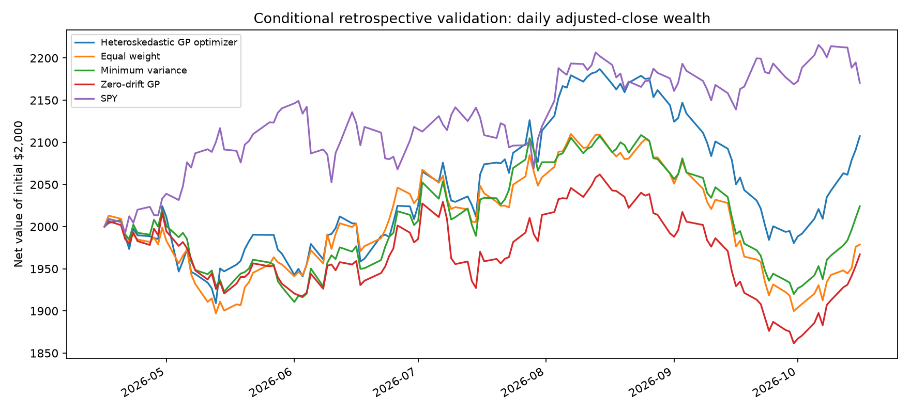
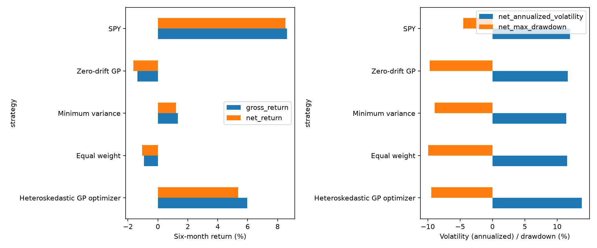
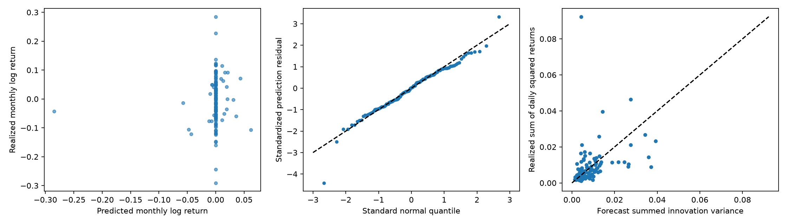
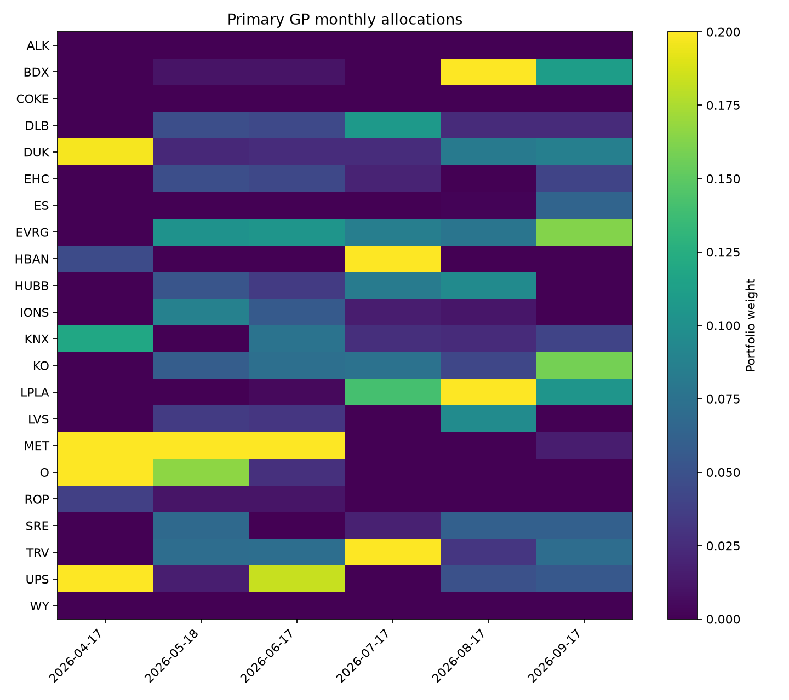
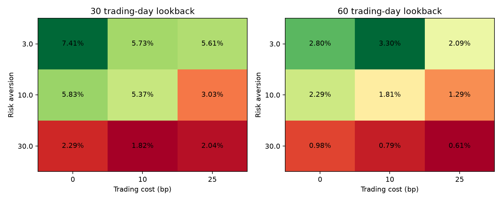

| Strategy | Six-month return | Ending $ | Sharpe | Max drawdown | Costs |
| --- | --- | --- | --- | --- | --- |
| Heteroskedastic GP optimizer | 5.37% | 2,107.36 | 0.82 | -9.44% | $11.57 |
| Equal weight | -1.06% | 1,978.82 | -0.13 | -9.96% | $2.57 |
| Minimum variance | 1.21% | 2,024.19 | 0.27 | -8.94% | $2.68 |
| Zero-drift GP | -1.65% | 1,967.08 | -0.23 | -9.72% | $5.56 |
| SPY | 8.53% | 2,170.53 | 1.42 | -4.49% | $2.00 |

# 22-stock heteroskedastic GP portfolio experiment

Completed October 18, 2026. All headline returns and Sharpe ratios are **net**. Initial wealth is $2,000; fractional shares, zero risk-free rate, and 10 bp charged on each dollar bought or sold. No terminal liquidation is charged.

**This is a retrospective conditional backtest.** The 22 stocks were selected on October 18 using information that includes this validation period. Chronological GP estimation does not make the historical evaluation independent of that screening. These results test allocation conditional on a hindsight-selected universe, not a prospective stock-selection-and-allocation strategy.

## Observed portfolio performance

| Strategy | Gross return | Net return | Ann. return* | Ann. vol. | Best month | Worst month | Positive months |
| --- | --- | --- | --- | --- | --- | --- | --- |
| Heteroskedastic GP optimizer | 5.97% | 5.37% | 10.93% | 13.81% | 5.91% | -5.35% | 67% |
| Equal weight | -0.93% | -1.06% | -2.09% | 11.56% | 4.77% | -4.98% | 50% |
| Minimum variance | 1.34% | 1.21% | 2.41% | 11.39% | 3.76% | -4.43% | 67% |
| Zero-drift GP | -1.37% | -1.65% | -3.24% | 11.64% | 4.08% | -5.36% | 67% |
| SPY | 8.64% | 8.53% | 17.63% | 11.97% | 4.67% | -1.68% | 67% |
| Native zero-drift GP | -2.55% | -2.84% | -5.55% | 11.71% | 4.12% | -5.65% | 67% |
| GP maximum mean | 13.46% | 13.20% | 27.88% | 17.52% | 9.47% | -3.03% | 67% |

*Annualized return is an extrapolation from only six months (252 divided by the number of daily validation returns). Volatility and Sharpe use daily simple marked-to-market returns and 252 sessions/year; Sharpe subtracts a zero daily risk-free return. Maximum drawdown includes the initial cash anchor and uses daily closes. Gross results replay the same target allocations without fees; they do not reoptimize the strategy with a zero cost penalty.*





Primary monthly results (open-to-open holdings, final period open-to-close):

| Rebalance | Net return | Gross return | Cost $ | Two-sided turnover | At cap | Effective holdings |
| --- | --- | --- | --- | --- | --- | --- |
| 2026-04-17 | -2.44% | -2.34% | 2.00 | 99.90% | 3 | 5.66 |
| 2026-05-18 | 2.33% | 2.45% | 2.27 | 116.56% | 1 | 9.20 |
| 2026-06-17 | 3.15% | 3.20% | 1.06 | 52.85% | 1 | 8.96 |
| 2026-07-17 | 5.91% | 6.04% | 2.45 | 119.06% | 2 | 7.47 |
| 2026-08-17 | -5.35% | -5.25% | 2.23 | 102.10% | 2 | 8.23 |
| 2026-09-17 | 2.06% | 2.14% | 1.56 | 75.68% | 0 | 9.73 |

## Answers to the scientific questions

1. **Incremental performance:** the GP outperformed equal weight by +6.43 percentage points net and +6.90 points gross. It underperformed SPY by -3.16 points net and -2.67 points gross. Its daily annualized volatility was 13.81%, versus 11.56% equal weight and 11.97% SPY. A positive return alone is not evidence of success.
2. **Value of drift:** the estimated-drift portfolio returned 5.37%, versus -1.65% for the identical-covariance zero-mean control, a +7.01-point difference. Across 132 stock-month forecasts, drift MAE was 0.064170, versus 0.062632 with zero mean; RMSE was 0.083334, versus 0.080866; empirical CRPS was 0.044847, versus 0.044308. Drift did not improve either MAE or RMSE. No significance claim is justified by six shared market months. The native zero-drift GP also appears above; it refits the existing `mean_gp=False` model and therefore changes volatility as well as removing drift.
3. **Volatility and risk calibration:** the primary 90% and 68% stock-return intervals covered 92.4% and 73.5%; standardized residual RMS was 1.004 (one is the second-moment reference). Realized summed daily squared returns divided by predicted innovation variance was 1.022. The GP portfolio's 90% gross holding-log-return interval covered 83% of six months; its standardized residual RMS was 1.249. These are descriptive calibration checks, not proof of calibrated tail risk; cross-asset observations are correlated and portfolio forecast/holding clocks differ slightly.
4. **Allocation stability:** average two-sided monthly traded notional was 94.4% of pretrade wealth, including the initial purchase; subsequent-month average was 93.3%. Adding independent 10 bp monthly-log-drift perturbations (ten frozen-seed trials per rebalance) changed weights by a median L1 distance 0.169, with maximum 0.457. This measures local allocation sensitivity, not an additional optimized strategy. The median L1 change corresponds to reallocating roughly 8.4% of portfolio weight between names, so the primary allocations were sensitive to small drift perturbations. Mean effective holdings were 8.21.
5. **Concentration:** 9 of 132 primary asset-month weights reached the 20% cap; 5 of six rebalances contained at least one capped weight. Average cap count was 1.50; the largest target weight was 20.00%. Full weights, pretrade drifted weights and per-asset gross return contributions are saved.
6. **Distribution of gains:** 4 of six holding periods were positive. Best/worst monthly returns were 5.91%/-5.35%. The two largest monthly dollar changes summed to $184.71, versus the total net dollar change $107.36; this comparison is signed and can exceed total profit when other periods lose money. The other four periods together lost money in dollar terms: the positive total depended on the two strongest periods.
7. **Sensitivity:** across all 18 predefined combinations, net returns ranged from 0.61% to 7.41%, and daily Sharpe from 0.16 to 1.00. At lambda 10 and 10 bp, extending the lookback from 30 to 60 days changed net return from 5.37% to 1.81%. These are descriptive alternatives; the primary configuration remains 30 trading days, lambda 10 and 10 bp. No winning validation configuration was promoted to primary.
8. **Further testing:** a prospective, frozen-universe experiment is needed before drawing investment conclusions. Any advantage here must survive an untouched period, the same cost accounting, a wider universe selected without hindsight, and uncertainty estimates that respect common market months. The drift-versus-zero comparison is the direct evidence for expected-return value; comparing zero-drift GP with historical minimum variance examines risk allocation, although both risk estimates use different lookbacks. The zero-drift GP also underperformed historical minimum variance (-1.65% versus 1.21% net), so this sample does not demonstrate incremental portfolio value from its volatility model. Six months cannot identify a stable Sharpe advantage or validate rare-event coverage.

## Forecast accuracy and uncertainty

All means, standard deviations, quantiles, MAE, RMSE and CRPS below are in **dimensionless monthly log-return units**. Multiply by 100 for log percentage points. Gaussian log predictive density in the CSV is a moment-matched Gaussian diagnostic, not the exact non-Gaussian mixture density. CRPS uses simulated distributions. Latent drift uncertainty is saved separately from realized innovation variance.

| lookback | variant | mae | rmse | coverage90 | coverage68 | crps | rms_z | realized_to_predicted_variance |
| --- | --- | --- | --- | --- | --- | --- | --- | --- |
| 30 | estimated_drift | 0.06417 | 0.08333 | 92.4% | 73.5% | 0.04485 | 1.00385 | 1.02223 |
| 30 | same_covariance_zero_drift | 0.06263 | 0.08087 | 92.4% | 71.2% | 0.04431 | 1.00211 | 1.02223 |
| 30 | native_zero_drift | 0.06263 | 0.08087 | 91.7% | 68.2% | 0.04412 | 1.02878 | 0.99996 |
| 60 | estimated_drift | 0.06300 | 0.08113 | 94.7% | 68.2% | 0.04411 | 0.93686 | 0.99496 |
| 60 | same_covariance_zero_drift | 0.06263 | 0.08087 | 94.7% | 70.5% | 0.04404 | 0.93611 | 0.99496 |
| 60 | native_zero_drift | 0.06263 | 0.08087 | 95.5% | 66.7% | 0.04388 | 0.95420 | 0.98763 |

Primary pooled predicted/realized-return Pearson correlation: **0.077**. Mean monthly cross-sectional Spearman correlation: **0.175**. The mean absolute predicted drift was 0.006186; the mean latent-drift fraction of monthly predictive variance was 6.57%. Zero means have undefined rank and Pearson correlations, left blank rather than given artificial scores. Interval levels are 5–95% and 16–84%, not 95% and exactly one normal standard deviation.



Ticker ranking, lowest to highest primary monthly log-return MAE (six predictions each, not a reliable investment ranking):

| rank | ticker | mae | rmse | coverage90 |
| --- | --- | --- | --- | --- |
| 1 | DUK | 0.03154 | 0.03759 | 100.0% |
| 2 | EVRG | 0.03344 | 0.03479 | 100.0% |
| 3 | KO | 0.03920 | 0.04813 | 83.3% |
| 4 | MET | 0.04091 | 0.04709 | 100.0% |
| 5 | TRV | 0.04193 | 0.05198 | 83.3% |
| 6 | SRE | 0.04198 | 0.04716 | 100.0% |
| 7 | ES | 0.04266 | 0.04847 | 100.0% |
| 8 | O | 0.05395 | 0.05798 | 83.3% |
| 9 | EHC | 0.05465 | 0.06965 | 100.0% |
| 10 | KNX | 0.05628 | 0.06805 | 100.0% |
| 11 | COKE | 0.05677 | 0.06208 | 100.0% |
| 12 | WY | 0.05927 | 0.07106 | 100.0% |
| 13 | BDX | 0.06798 | 0.07867 | 100.0% |
| 14 | LVS | 0.07033 | 0.07664 | 83.3% |
| 15 | ROP | 0.07150 | 0.07795 | 83.3% |
| 16 | UPS | 0.07286 | 0.08347 | 100.0% |
| 17 | HUBB | 0.07316 | 0.08174 | 100.0% |
| 18 | LPLA | 0.07509 | 0.09128 | 100.0% |
| 19 | HBAN | 0.08052 | 0.08741 | 83.3% |
| 20 | DLB | 0.09163 | 0.11922 | 66.7% |
| 21 | ALK | 0.11413 | 0.14304 | 83.3% |
| 22 | IONS | 0.14195 | 0.18485 | 83.3% |

## Data, dates and execution

The exact 22 symbols were parsed from the recommendation table in [the source report](../../reports/monthly-stock-screen-2026-10-18/REPORT.md), preserving its order, and verified unique. Neither screen scores nor later ticker ranks enter the GP or allocation rule. `tickers.txt` is the canonical extracted list. SPY is a separate market reference.

Original inputs are the repository's cached Yahoo Finance/yfinance histories, requested with `auto_adjust=False`; each original CSV's SHA-256 matched its retrieval metadata. See [data_integrity.csv](data_integrity.csv) for per-ticker source URLs, retrieval times, original hashes, corporate actions and jump magnitudes. The experiment snapshots the exact date slice under `data/`; no downloads or new external dependencies were needed. There are 252 price sessions, 251 daily-return observations per instrument, and **zero missing required price observations**, with no forward filling. There are 92 dividend-event rows and 1 split-event rows across the 23 instruments in the slice. Latest unadjusted stock closes remain above $10; the historical adjusted series can differ from historical executable nominal prices.

`Adj Close` is Yahoo's split/dividend-adjusted total-return proxy. Adjusted Open is `Open × Adj Close / Close`; this keeps opens and closes in consistent adjusted share units. Dollar accounting treats fractional units as automatically reinvesting distributions without extra reinvestment costs. Vendor revisions and corporate-action adjustment accuracy are not independently audited. These are retrospective vendor files, not point-in-time archived histories; hashes establish reproducibility, not correctness.

Anchor close: October 16, 2025. Training returns: **October 17, 2025–April 16, 2026**. Validation: **April 17–October 16, 2026**. The first half initializes the models and historical covariance; no evaluation data select hyperparameters. Six training months are too few for robust risk-aversion tuning, so lambda is fixed in advance. The GP's rolling 30/60-day inference and its existing regularized hyperparameter rules remain frozen; it is refit as newly observed data arrive. The initial six months are available, but intentionally do not all enter the primary 30-day GP fit.

| origin | execution | target_end | horizon |
| --- | --- | --- | --- |
| 2026-04-16 | 2026-04-17 | 2026-05-15 | 21 |
| 2026-05-15 | 2026-05-18 | 2026-06-16 | 21 |
| 2026-06-16 | 2026-06-17 | 2026-07-16 | 20 |
| 2026-07-16 | 2026-07-17 | 2026-08-14 | 21 |
| 2026-08-14 | 2026-08-17 | 2026-09-16 | 22 |
| 2026-09-16 | 2026-09-17 | 2026-10-16 | 22 |

At each rebalance the GP uses returns ending at the **previous close**. Trades are priced at the next session's adjusted Open, with weights optimized using the just-observed opening holdings values and frozen forecasts. This is an immediately-after-open daily-bar fill proxy, not a guarantee of executing at an auction price after seeing it; the proportional allowance absorbs modeled trading friction but does not reconstruct bid/ask spreads or market impact. Same-day High/Low/Close do not enter the decision. The adjustment factor is retrospective corporate-action normalization, not a forecasting feature.

**Forecast-clock approximation:** close-return GP forecasts run from prior close through the session before the next rebalance; holdings run from execution open to next execution open (last period to October 16 close). The horizons are similar but overnight endpoints differ. `monthly_forecasts.csv` saves both forecast-aligned realized log returns and actual holding log returns; stock diagnostics use the former, portfolio risk diagnostics the latter. There is no same-close execution using that close's fitted return. This alignment approximation should be removed in a future intraday/execution-aware model.

## GP architecture, dependence and optimization

[ARCHITECTURE.md](ARCHITECTURE.md) documents the existing modules reviewed before coding. The implementation calls the existing `stock_api.heteroskedastic.fit_latent_returns`, `_future` and `_root`; it does not replace the GP with a constant-volatility or independent-day model. The daily likelihood is `r = scale × (f + exp(g/2) ε)`, with Gaussian variational latent drift f and log variance g and Matérn-3/2 temporal kernels. The scale is fitted using only the window's uncentered RMS returns. Kernel amplitudes and length scales are re-estimated at each origin and stay fixed within the forecast; latent f and g evolve and retain their full future temporal covariances. Regularization shrinks drift toward zero. Hyperparameters are plug-in optimized values, not fully Bayesian draws.

Monthly mean log return is `scale × sum(E[f])`. Its variance is `scale² × (sum(Cov[f]) + sum(exp(E[g]+Var[g]/2)))`; this separates latent-drift uncertainty from future realized-return noise. There are 10,000 antithetic joint paths per origin/variant/lookback. Full temporal covariance is propagated rather than multiplying one daily forecast by 21. `gp_parameter_history.csv` saves all fitted kernel parameters, scale, convergence information and objective; `gp_forward_latents.csv` shows daily expected drift, variance and uncertainty evolution.

Contemporaneous correlation uses standardized GP training residuals and fixed **50% shrinkage toward identity**. Residuals are smoothed in-sample latent-fit residuals, not independently held-out innovations. Correlated Gaussian driver families couple asset innovations and latent drift using that matrix; latent log-volatility drivers use its elementwise square (a PSD shared-volatility construction). The three driver families are independent of each other. Each ticker retains its own temporal GP covariance. This is an explicit approximate joint construction, not an inferred multi-output GP or estimated volatility cross-kernel. The existing multitask price GP reports zero cross-covariance and is not a suitable replacement.

The terminal Monte Carlo log-return covariance is PSD and rescaled to exactly preserve analytic GP marginal variances. The simulation rescaling factors are recorded; this finite-sample moment correction slightly adjusts empirical quantiles. The squared-correlation log-volatility construction and 50% shrinkage are assumptions, not empirically selected optimal values. Joint terminal samples, covariance, correlation and marginal moments are saved under `predictive/`.

**Moment limitation:** the existing lognormal variance mixture has finite log-return moments, but exponentiating its Gaussian return mixtures need not produce finite population arithmetic-return moments. Therefore the optimizer explicitly uses **monthly log-return means and covariance**, not unstable Monte Carlo estimates of expected simple returns. This is a documented utility approximation to the requested return objective: weighted asset log returns are not exactly portfolio log returns. Realized wealth uses exact simple price ratios; portfolio predictive log returns use `log(sum(w × exp(R_log)))`. No predictive tail clipping is used. No finite expected dollar return is claimed.

The convex objective is `w·mu_log − lambda/2 w'Σ_log w − cost_rate ||w−w_pre||₁`, with sum one and 0–20% bounds. SciPy SLSQP solves a quadratic objective with linear epigraph constraints and analytic gradients, and failures stop execution. The zero-drift control sets mu to zero with the **identical primary GP covariance**, giving variance minimization plus trading costs. Historical minimum variance uses up to 126 prior daily returns, 50% correlation shrinkage, and horizon scaling, with the same lambda/cost tradeoff and bounds. Equal weight is monthly rebalanced; SPY is buy-and-hold and, as an external single-asset reference, exempt from the 20% cap. The optional maximum-mean portfolio sets lambda to zero but retains the trading penalty.

Pretrade weights reflect actual opening-price drift. The realized fee solves `C = c × sum(abs((V−C)w − old_asset_dollars))`, so holdings plus fee exactly equal available wealth. The optimization's turnover penalty guides allocations; it is not separately subtracted from wealth. Initial purchase costs are included, and no cash is borrowed to pay fees. Two-sided turnover counts all purchases and sales; the CSV also includes half of that as one-way turnover. Monthly holding returns include the fee at their start and exclude the next rebalance fee. Daily equity marks use adjusted closes, so monthly boundaries differ from a naive calendar-close resampling.



## Frozen sensitivity analysis

| lookback | risk_aversion | cost_bps | net_return | net_sharpe | net_max_drawdown | costs |
| --- | --- | --- | --- | --- | --- | --- |
| 30.0 | 3.0 | 0.0 | 7.41% | 1.00 | -9.66% | 0.00 |
| 30.0 | 3.0 | 10.0 | 5.73% | 0.80 | -9.23% | 10.24 |
| 30.0 | 3.0 | 25.0 | 5.61% | 0.75 | -9.43% | 20.07 |
| 30.0 | 10.0 | 0.0 | 5.83% | 0.88 | -9.63% | 0.00 |
| 30.0 | 10.0 | 10.0 | 5.37% | 0.82 | -9.44% | 11.57 |
| 30.0 | 10.0 | 25.0 | 3.03% | 0.49 | -9.63% | 23.40 |
| 30.0 | 30.0 | 0.0 | 2.29% | 0.43 | -10.04% | 0.00 |
| 30.0 | 30.0 | 10.0 | 1.82% | 0.35 | -10.06% | 9.90 |
| 30.0 | 30.0 | 25.0 | 2.04% | 0.39 | -9.97% | 21.79 |
| 60.0 | 3.0 | 0.0 | 2.80% | 0.46 | -8.44% | 0.00 |
| 60.0 | 3.0 | 10.0 | 3.30% | 0.52 | -8.28% | 8.29 |
| 60.0 | 3.0 | 25.0 | 2.09% | 0.36 | -9.15% | 17.91 |
| 60.0 | 10.0 | 0.0 | 2.29% | 0.40 | -9.19% | 0.00 |
| 60.0 | 10.0 | 10.0 | 1.81% | 0.33 | -8.86% | 9.67 |
| 60.0 | 10.0 | 25.0 | 1.29% | 0.26 | -8.55% | 20.49 |
| 60.0 | 30.0 | 0.0 | 0.98% | 0.22 | -9.55% | 0.00 |
| 60.0 | 30.0 | 10.0 | 0.79% | 0.19 | -9.50% | 7.90 |
| 60.0 | 30.0 | 25.0 | 0.61% | 0.16 | -9.33% | 16.86 |



These cost variants reoptimize with their stated cost penalty and replay their own net accounting. They differ from gross results, which hold the fee-paying strategy's target allocations fixed. Forecasts are cached across lambda/cost variants, keeping the predictive inputs identical.

## Reproducibility and limits

Run from repository root:

```bash
MPLCONFIGDIR=/tmp/stocks-matplotlib-audit OPENBLAS_NUM_THREADS=1 .conda-env/bin/python -m unittest tests.test_portfolio
MPLCONFIGDIR=/tmp/stocks-matplotlib-audit OPENBLAS_NUM_THREADS=1 .conda-env/bin/python scripts/run_portfolio_gp_22.py
```

`config.yaml` (JSON syntax, valid YAML) was written before execution. Seed: 20261018. `manifest.json` records software versions, exact command and source hashes. Checkpoints bind GP inputs, configuration and model-code hashes. There were **528 successful GP fits**, 0 recorded nonconverged selected fits, and 0 portfolio optimization failures. Only successful starts returned by the original two-start GP routine are exposed; a selected fit with one successful start does not imply both starts converged. All six periods and all 22 names were retained. `run.log` records execution and captured warnings.

The independent reconstruction audit in `audit.json` checks all 24 strategy paths, their costs and daily holdings against saved prices. Source files and environment specifications are snapshotted under `source/`. Run `.conda-env/bin/python scripts/audit_portfolio_gp_22.py` to repeat it.

Primary constraints, covariance PSD and marginal variance preservation, transaction-cost budgets, and chronological separation have lightweight tests. `monthly_weights.csv`, `monthly_performance.csv` and `portfolio_daily.csv` permit independent reconstruction. `forecast_diagnostics.csv` separates mean error, proper scores and variance diagnostics. `ticker_error_ranking.csv` provides the requested low-to-high forecast error ordering for this experiment's different six-month interval.

The principal limitations are hindsight selection and survivorship (current constituents with adequate histories), six shared market months, plug-in hyperparameters and variational approximation, uncertain cross-asset/latent-volatility dependence, a log-utility approximation, vendor-adjusted data revisions, and opening execution/forecast-clock approximations. No hypothesis test treats the 132 asset-months as independent. No definitive claim of predictive drift, stable risk-adjusted superiority, or investable edge follows from this experiment alone.
