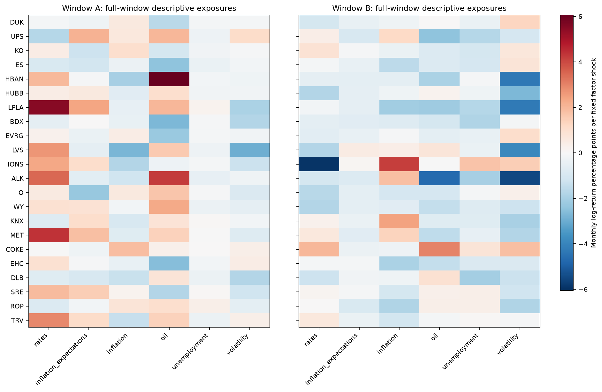
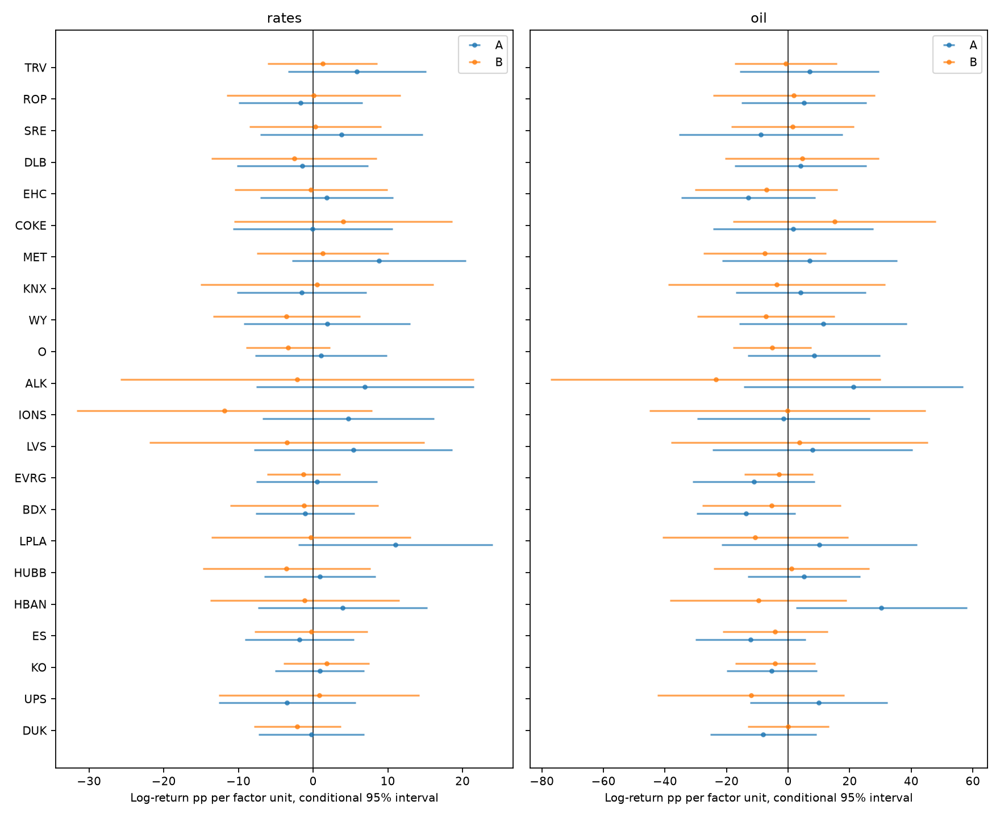
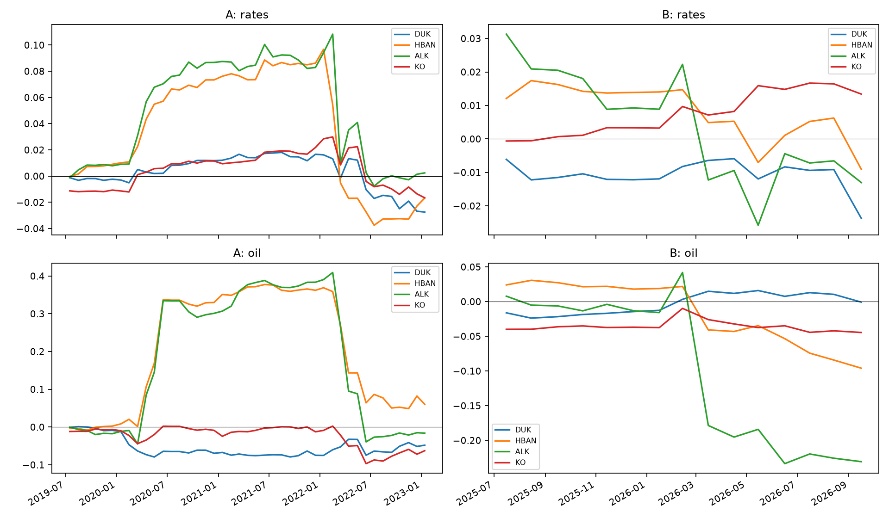
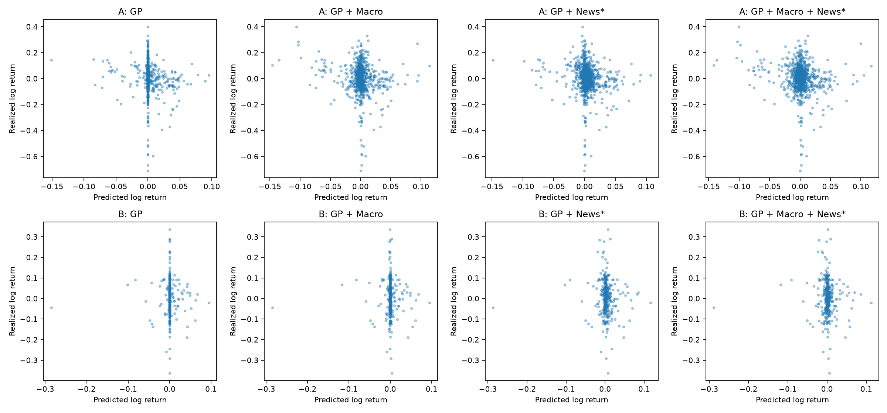
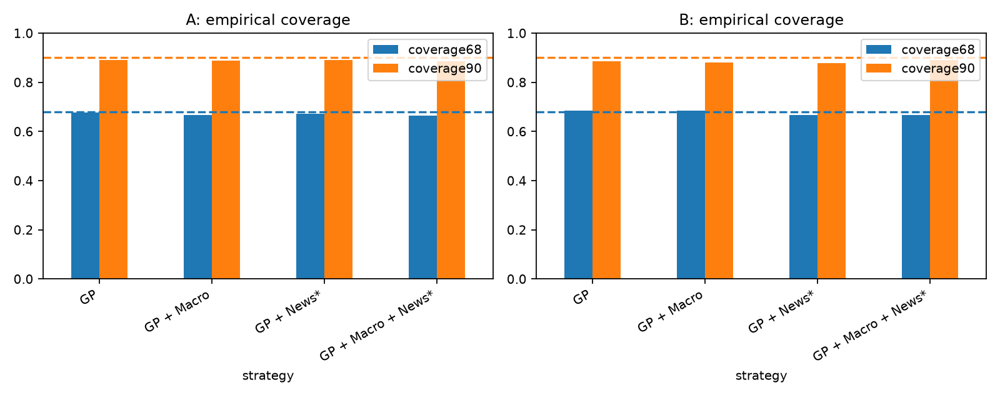
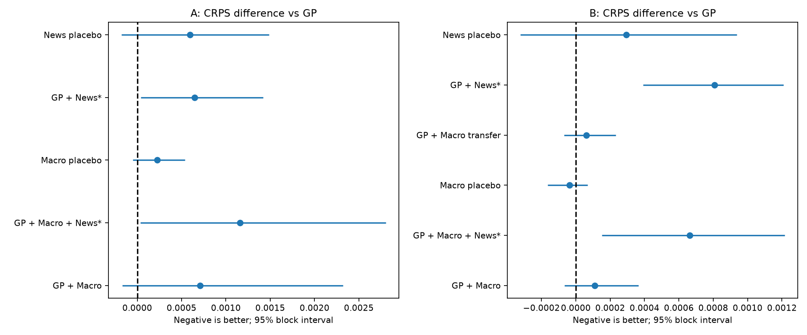
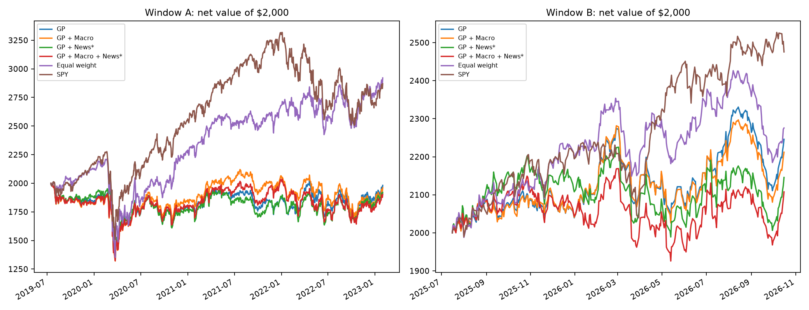
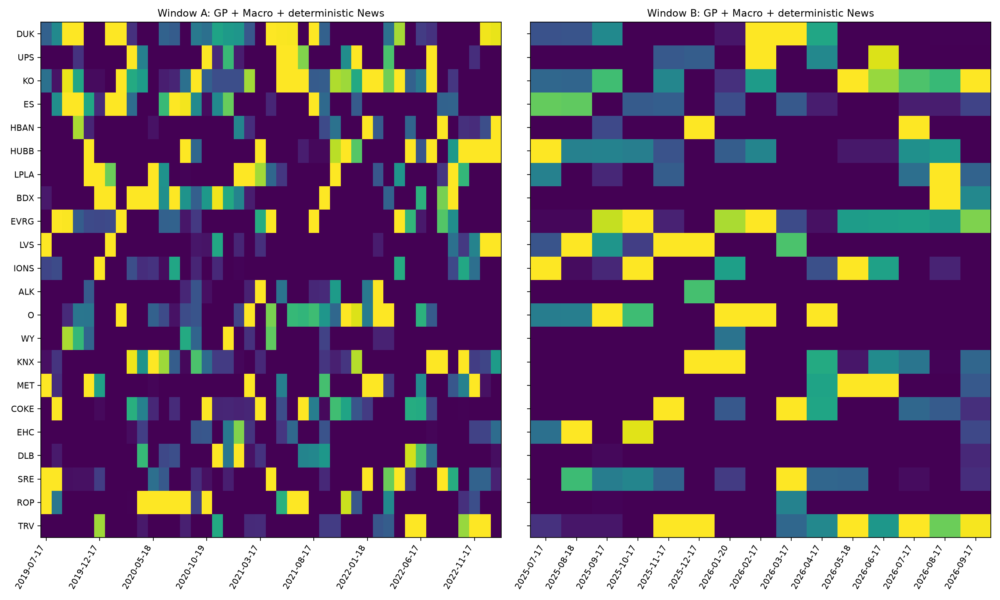
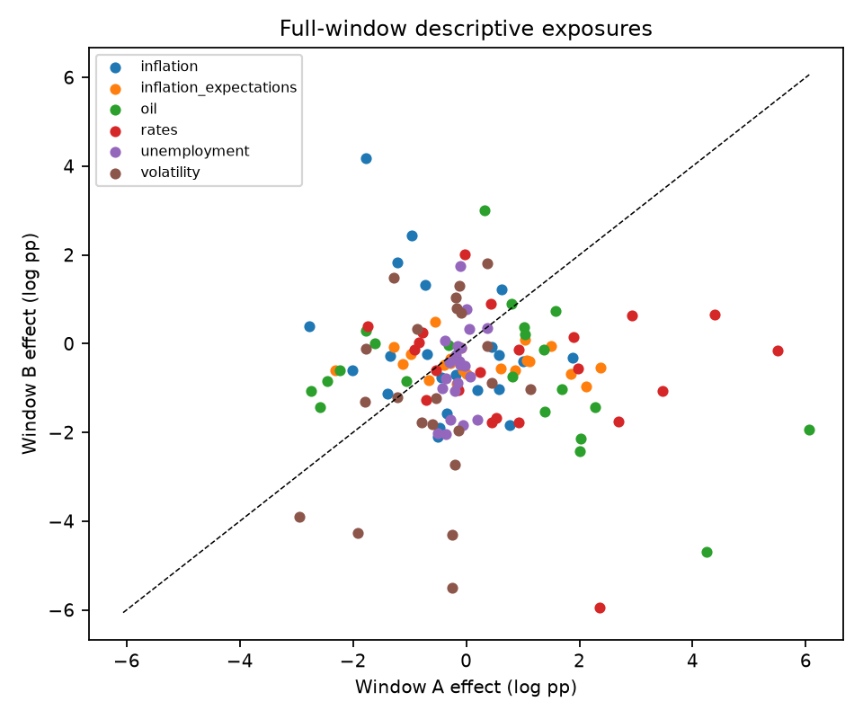
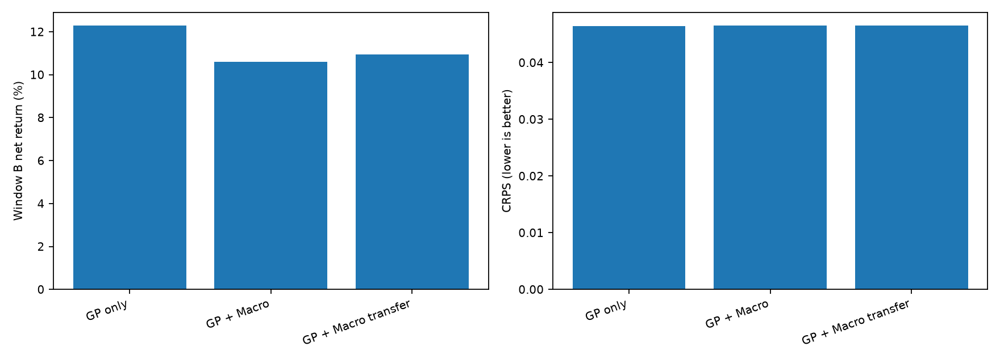

# Macro and news information beyond the heteroskedastic GP

**Finding: the tested macro and deterministic-news additions did not deliver a consistent predictive or portfolio advantage.**

The complete feasible study was executed on the original 22 symbols, using the existing GP, joint simulation, optimizer and transaction-cost accounting. **No LLM was run.** News results refer solely to the deterministic, timestamped baseline. These are two independent historical experiments, with a separate reset comparison to the earlier six-month backtest.

**Window A — July 17, 2019–January 31, 2023**

| Strategy | Net return | Ending $ | Sharpe | Max drawdown | Turnover | Costs |
| --- | --- | --- | --- | --- | --- | --- |
| GP only | -0.93% | 1,981.48 | 0.10 | -33.59% | 92.3% | $72.71 |
| GP + Macro | -1.98% | 1,960.45 | 0.09 | -33.99% | 95.4% | $77.05 |
| GP + News (deterministic) | -3.99% | 1,920.16 | 0.06 | -32.43% | 107.4% | $83.76 |
| GP + Macro + News (deterministic) | -4.84% | 1,903.17 | 0.05 | -33.87% | 106.2% | $83.74 |
| Equal weight | 46.04% | 2,920.77 | 0.56 | -38.86% | 7.3% | $6.96 |
| SPY | 43.47% | 2,869.34 | 0.55 | -33.72% | 2.3% | $2.00 |

**Window B — July 17, 2025–October 16, 2026**

| Strategy | Net return | Ending $ | Sharpe | Max drawdown | Turnover | Costs |
| --- | --- | --- | --- | --- | --- | --- |
| GP only | 12.30% | 2,245.90 | 0.82 | -10.52% | 92.9% | $29.66 |
| GP + Macro | 10.60% | 2,211.95 | 0.72 | -11.19% | 95.4% | $30.40 |
| GP + News (deterministic) | 7.28% | 2,145.65 | 0.49 | -10.61% | 106.3% | $33.58 |
| GP + Macro + News (deterministic) | 5.38% | 2,107.65 | 0.38 | -11.20% | 106.5% | $32.81 |
| Equal weight | 13.78% | 2,275.58 | 0.94 | -9.96% | 12.2% | $3.85 |
| SPY | 23.77% | 2,475.50 | 1.44 | -8.88% | 6.7% | $2.00 |

**Hindsight selection applies to both windows.** The 22 names were selected using the October 2026 screen. The April–October 2026 interval was already studied. Neither window validates the complete stock-selection-and-allocation strategy prospectively. No configuration was selected to maximize these returns.

## I. Macro exposures

The six-factor matrix measures rate changes, market inflation compensation, vintage-known CPI inflation, oil prices, unemployment and VIX, conditional on SPY. [Window A](RESULTS_WINDOW_A.md) and [Window B](RESULTS_WINDOW_B.md) list the largest positive/negative coefficients with uncertainty for every factor. All 22 stocks, coefficient trajectories and conditional posterior intervals are saved, including negative findings.







| Factor | A: highest / lowest | B: highest / lowest |
| --- | --- | --- |
| rates | LPLA (+0.110) / UPS (-0.035) | COKE (+0.040) / IONS (-0.119) |
| inflation_expectations | LPLA (+0.047) / O (-0.046) | LVS (+0.010) / UPS (-0.019) |
| inflation | COKE (+0.038) / LVS (-0.055) | IONS (+0.084) / LPLA (-0.042) |
| oil | HBAN (+0.303) / BDX (-0.137) | COKE (+0.150) / ALK (-0.235) |
| unemployment | ROP (+0.015) / ALK (-0.020) | IONS (+0.070) / DLB (-0.082) |
| volatility | UPS (+0.057) / LVS (-0.148) | COKE (+0.091) / ALK (-0.275) |

Only 2 of 132 A coefficients and 1 of 132 B coefficients have conditional 95% intervals excluding zero, before any multiplicity correction. These counts do not establish reliable individual exposures. Highest/lowest are point-estimate rankings, not statistically established orderings; the window reports give the intervals.

The matrix is descriptive. Rate changes are not pure FOMC surprises, inflation compensation includes other market components, and unemployment is only one growth proxy. Sector/economic intuition did not hard-code exposure signs. Zero-centered priors and fixed factor units prevent unsupported sector narratives from becoming signals. Large intervals and changes of sign indicate limited identification; shrinkage intervals are model-dependent rather than causal confidence bounds.

News mappings for policy, inflation/growth language, trade attention and sampled conflicts are in the exposure CSVs under `news_incremental`. They estimate incremental predictive associations, not structural sensitivities to geopolitical conflict or trade disruption. Sparse policy mentions, sampled media coverage and common market reactions make company-specific conclusions particularly uncertain. Full highest/lowest news coefficients and intervals are in `exposures/news_sensitivities.csv`; zero coefficients for a feature absent from training are labeled not identified, rather than assigning an arbitrary ticker a sensitivity rank.

| window | factor | highest | highest_coefficient | lowest | lowest_coefficient |
| --- | --- | --- | --- | --- | --- |
| A | conflict_attention | LVS | +0.01057 | IONS | -0.00162 |
| A | growth_weakness | UPS | -0.00009 | ROP | -0.01017 |
| A | inflation_attention | COKE | +0.01545 | IONS | -0.00830 |
| A | policy_direction | DUK | +0.00620 | COKE | -0.01064 |
| A | trade_attention | not identified | +0.00000 | not identified | +0.00000 |
| B | conflict_attention | TRV | +0.00548 | LVS | -0.00716 |
| B | growth_weakness | UPS | +0.00866 | EHC | -0.00709 |
| B | inflation_attention | LVS | +0.00712 | UPS | -0.00452 |
| B | policy_direction | EHC | +0.00665 | LPLA | -0.01040 |
| B | trade_attention | not identified | +0.00000 | not identified | +0.00000 |

## II. Incremental predictive information

Price-only versus macro CRPS was **0.05536 vs 0.05607 in A**, and **0.04645 vs 0.04656 in B**. Lower is better. News-only CRPS was 0.05601/0.04725; combined CRPS was 0.05652/0.04711. These small differences must be assessed against the paired market-month intervals in the window reports, not thousands of purported independent asset-month observations.



Price-only 90% stock-return coverage was 89.1% in A and 88.5% in B. Standardized residual RMS was 1.54/1.12; realized summed daily squared returns divided by forecast innovation variance was 0.78/1.07. Near-nominal interval coverage does not establish correct tail-risk calibration, particularly in A. All augmented models inherit the same marginal variances by design.





Ex-ante factor-change forecasting versus predicting no change (positive MSE skill is better):

| window | factor | rmse | zero_change_rmse | mse_skill_vs_zero |
| --- | --- | --- | --- | --- |
| A | inflation | 0.41844 | 0.49630 | 28.91% |
| A | inflation_expectations | 0.19881 | 0.19497 | -3.98% |
| A | oil | 0.11213 | 0.10994 | -4.02% |
| A | rates | 0.28001 | 0.28669 | 4.61% |
| A | unemployment | 2.26235 | 1.67360 | -82.73% |
| A | volatility | 0.29033 | 0.29258 | 1.53% |
| B | inflation | 0.37920 | 0.36626 | -7.19% |
| B | inflation_expectations | 0.07246 | 0.07113 | -3.76% |
| B | oil | 0.10713 | 0.10433 | -5.44% |
| B | rates | 0.16730 | 0.17080 | 4.06% |
| B | unemployment | 0.07877 | 0.07746 | -3.42% |
| B | volatility | 0.18155 | 0.17979 | -1.97% |

The augmentation targets prior **out-of-sample GP residuals**. Model B fits those residuals on historical realized factor changes, then evaluates the coefficient mapping on ridge AR forecasts of future changes. Realized future macro observations are used only as later training labels and scoring targets. Model C maps contemporaneously available news features to completed future residuals. Model D fits macro and news jointly rather than blindly summing separately fitted correlated corrections. Intercepts and expected SPY innovation are set to zero when applying corrections, isolating these feature families from an extra unconditional-return intercept.

This is deliberately a **matched conditional mean experiment**: all models retain the same GP covariance and mean-shift the same 10,000 joint paths. It does not test a news-driven volatility GP. Mapping coefficient uncertainty is saved but not independently added to the GP's risk, because both are inferred from overlapping returns and the GP already captures macro-induced realized volatility. Consequently augmented predictive distributions omit factor-forecast and mapping uncertainty; they are plug-in conditional distributions, and calibration may be overconfident. A fully joint macro/GP latent model is a future extension, not something implemented here.

## III. Portfolio performance and event behavior

Macro net-return differences from GP were **-1.05 pp in A** and **-1.70 pp in B**. Combined macro/news differences were **-3.92 pp** and **-6.91 pp**. Differences in dollar gains across windows should not be compared without accounting for their different lengths. Gross and net returns, daily risk metrics, turnover and costs are all saved in `ablation_results.csv`.





[Window reports](RESULTS_WINDOW_A.md) identify the largest contributing stock and month differences. Placebo variants preserve the cross-asset label vectors but shuffle completed historical predictor rows with fixed seeds. They never use unavailable future features. This retains common stock shocks but disrupts predictor serial dependence; one placebo realization is a diagnostic, not a randomization test proving information content.

Event studies cover all 48 archived FOMC statements plus the three prespecified [WHO pandemic characterization](https://www.who.int/news-room/speeches/item/who-director-general-s-opening-remarks-at-the-media-briefing-on-covid-19---11-march-2020), [Ukraine invasion](https://ukraine.un.org/en/173250-statement-secretary-general-%E2%80%93-ukraine), and [April 2025 tariff announcement](https://www.govinfo.gov/content/pkg/DCPD-202500423/html/DCPD-202500423.htm) dates. A market model is fitted on up to 60 prior daily returns ending five sessions before the event; fewer than 40 observations causes an explicit exclusion. Cumulative abnormal log returns use sessions 0 through +5. Some announcements occurred after that day's close, so this broad window includes a pre-announcement return; it is not an intraday identification design. Concurrent events confound attribution. The tariff event falls in B's warm-up, so no evaluation portfolio performance is claimed around it.

`exposures/event_studies.csv` contains 1078 ticker-event rows; `portfolios/event_performance.csv` saves available evaluation-portfolio event returns. Available six-session event portfolio returns:

| window | event | Equal weight | GP + Macro | GP + Macro + News (deterministic) | GP + News (deterministic) | GP only | SPY |
| --- | --- | --- | --- | --- | --- | --- | --- |
| A | Russia invasion of Ukraine | 2.25% | 2.85% | -1.45% | -0.65% | 3.53% | 3.26% |
| A | WHO pandemic characterization | -20.22% | -14.53% | -14.65% | -14.80% | -14.79% | -16.79% |

These post-event observations are never backfilled into earlier news features. The augmentation cannot directly anticipate an increase in univariate predictive variance because its covariance is held fixed; it can only change expected returns and weights.


## IV. Cross-regime generalization

All of A's completed exposure observations, including COVID and Ukraine-era intervals, inform its final frozen posterior. B receives a weakened prior: covariance inflated by four and added precision capped at six standardized observations, so new evidence can overwhelm it. Descriptive exposures and the GP-residual macro mapping have separate frozen posteriors. GP histories and latent states reset in January 2025; no time series is concatenated across the gap.

Transfer net return in B: **10.95%**, versus **10.60%** without transfer and **12.30%** price-only. Transfer CRPS difference versus weak-prior macro: **-0.000051**, 95% block interval **[-0.000166, +0.000016]**.





End-of-window coefficient sign agreement across 22 stocks: inflation 45%, inflation_expectations 55%, oil 50%, rates 36%, unemployment 82%, volatility 59%. Agreement is not proof of stable causal exposure; shared priors, omitted variables and different observations can matter. The largest deteriorations in ex-post conditional exposure MSE under transfer were ALK (+0.001681), IONS (+0.001086), HBAN (+0.000967), LPLA (+0.000915), WY (+0.000068). Two post-hoc context checks show why stable company exposures cannot be assumed: [Alaska completed its Hawaiian acquisition on September 18, 2024](https://news.alaskaair.com/company/alaska-airlines-completes-acquisition-of-hawaiian-airlines-expanding-benefits-and-choice-for-travelers/), between the windows; [LPL completed its Commonwealth acquisition on August 1, 2025](https://www.sec.gov/Archives/edgar/data/1397911/000119312525171084/d810447d8k.htm), during Window B. Both ALK and LPLA appear among the transfer-calibration deteriorations. These facts motivate fundamental-aware priors but do not establish the cause of those errors. They were checked after scoring and were not used as predictive inputs or to choose parameters.

## V. Direct comparison with the earlier six-month experiment

Reset all portfolios to $2,000 on April 17, 2026, while retaining only information learned chronologically before each origin. The price-only distribution cache is reused only after matching ticker order, return window, dates, horizon and GP code hashes. The original GP net return is reproduced to numerical precision.

| Strategy | Net return | Ending $ | Sharpe | Max drawdown | Turnover | Costs |
| --- | --- | --- | --- | --- | --- | --- |
| GP only | 5.37% | 2,107.36 | 0.82 | -9.44% | 94.4% | $11.57 |
| GP + Macro | 4.32% | 2,086.47 | 0.68 | -9.43% | 94.0% | $11.48 |
| GP + News (deterministic) | 3.78% | 2,075.60 | 0.59 | -8.40% | 86.7% | $10.52 |
| GP + Macro + News (deterministic) | 5.03% | 2,100.64 | 0.74 | -7.57% | 87.5% | $10.63 |
| Equal weight | -1.06% | 1,978.82 | -0.13 | -9.96% | 21.4% | $2.57 |
| SPY | 8.53% | 2,170.53 | 1.42 | -4.49% | 16.7% | $2.00 |

This subset is exploratory and was not used to choose coefficients. Earlier portfolio holdings are not carried into this reset comparison.

## VI. Conclusions and next experiment

1. **Incremental macro signal: no demonstrated improvement in this implementation.** Macro augmentation worsened MAE and CRPS and reduced net portfolio returns in both windows. The macro-versus-GP CRPS intervals include zero; apparent changes are not statistically decisive. This does not show that economic information is intrinsically useless—only that the tested exposures and ex-ante factor forecasts failed to add value. Improvement in realized wealth alone does not establish forecast information. With only 43 A months and 15 B months, modest effects and regime variation remain uncertain; this is not confirmatory evidence for production use.
2. **Incremental historical news: no positive predictive evidence from this baseline.** News-only and joint models worsened CRPS in both windows; adding news to macro also worsened CRPS, with pointwise block intervals above zero in both windows. That is exploratory evidence of deterioration, not a multiple-testing-adjusted universal finding. News-only portfolio returns deteriorated in both windows and remained below simple benchmarks. Only deterministic features were evaluated. The combined-versus-macro paired comparison is the direct test of added news information and is saved separately. No claim of LLM improvement is possible: zero LLM classifications were run. Sparse GDELT snapshots and official statements are a narrow news baseline.
3. **Economic-prior transfer: a small, inconclusive improvement over the weak-prior macro model.** Transfer slightly improves B CRPS and net returns versus macro without transfer, but its paired CRPS interval includes zero and it remains below price-only GP. Ex-post conditional exposure MAE improves while RMSE slightly worsens. The numerical comparison above tests a deliberately weak transfer, with per-ticker exposure calibration, error scores, rank correlations, weights and returns saved. A favorable result on one metric does not show stability across all companies or establish a permanent economic relationship.
4. **Production inclusion:** no feature is approved for live allocation on this evidence. Vintage-safe macro state data and explicit availability controls are suitable research infrastructure. Rate, inflation, energy and volatility factors remain interpretable candidates for independent validation.
5. **Discard or treat as speculative:** current revised macro histories used as if historically known, realized future shocks used as forecasts, LLM confidence treated as market surprise, inferred company-specific conflict effects from sparse counts, and strong untempered cross-regime priors are not supported. The evaluated fixed-sample news signals remain speculative.
6. **Most informative next experiment:** freeze the universe, feature definitions and model rules, then collect a new prospective period with complete timestamped articles and a genuine held-out LLM-versus-deterministic comparison. Use an original-text-only prompt, measure leakage from pretrained event knowledge, preserve immutable inputs/outputs and compare incremental scores before optimizing for returns. Joint modeling of forecast/mapping uncertainty should precede claims about improved risk calibration.

## Reproducibility, execution and limits

The frozen [configuration](config.yaml), [architecture](ARCHITECTURE.md), [data-source audit](DATA_SOURCES.md), raw cached data and checksums are included. There are 72 macro states, 432 vintage CSVs, 48 actual FOMC statements, 2,094 deduplicated sampled conflict/sanction events, and 140 archive-coverage markers (markers are not articles). Two GDELT files are unavailable. Publication timestamps are retained where known, and ingestion/availability bounds are labeled rather than presented as original publication times.

```bash
.conda-env/bin/python scripts/download_macro_news_study.py
MPLCONFIGDIR=/tmp/stocks-matplotlib-audit OPENBLAS_NUM_THREADS=1 .conda-env/bin/python -m pytest tests/test_macro_news.py tests/test_portfolio.py -q
MPLCONFIGDIR=/tmp/stocks-matplotlib-audit OPENBLAS_NUM_THREADS=1 .conda-env/bin/python scripts/run_macro_news_study.py --smoke
MPLCONFIGDIR=/tmp/stocks-matplotlib-audit OPENBLAS_NUM_THREADS=1 .conda-env/bin/python scripts/run_macro_news_study.py
```

The downloader requires network access only for absent/unverified files. GP checkpoints bind data, horizon and model hashes; all models share the same cached base paths. Logs, input/code hashes, package versions and source snapshots are included. Failures are explicit; no synthetic data or substitute forecasts are emitted. The initial smoke test exposed an evaluation-boundary bug, which was corrected before the full backtest. Final classifier review also found and corrected a substring bug that could read “war” inside “forward”, and narrowed policy/inflation rules to avoid unrelated phrase matches. The corrected feature pipeline and all dependent scores/allocations were rerun; preliminary news results are superseded. No parameters were selected to improve profits. Core timestamp, prior/covariance, optimizer and accounting tests passed. `logs/audit.json` verifies chronological training, weight constraints, fees, monthly compounding and exact reproduction of the previous primary result. `logs/independent_audit.json` independently reconstructs daily net/gross holdings and verifies every included news timestamp and macro vintage. Full mapping posterior matrices and fitted design/target data are cached in `exposures/mapping_cache/`, and complete frozen regime posteriors are saved as NPZ files.

Limitations: hindsight universe selection and survivorship; differing window lengths; already explored 2026 subset; only monthly exposure observations despite daily prices; selected compact factors and fixed shrinkage; observation/release-date differences and unknown precise first-release times; residual macro revisions within valid historical vintages; noisy/sparse archived news; no genuine market expectations or policy surprises; no LLM; possible event-code errors; plug-in augmented uncertainty; approximate independent-error exposure posterior; unadjusted multiple comparisons; the inherited monthly log-return utility approximation and prior-close-to-next-open execution clock. The final January 2023 partial horizon has fewer sessions than other exposures. No positive result should be interpreted as a causal economic sensitivity or an investable edge without new evidence.
