| Strategy | Net return | Ending $ | Sharpe | Max drawdown | Turnover | Costs |
| --- | --- | --- | --- | --- | --- | --- |
| GP only | 475.47% | 11,509.38 | 3.35 | -14.00% | 88.6% | $63.24 |
| GP + Macro | 476.43% | 11,528.52 | 3.35 | -14.05% | 88.9% | $63.60 |
| GP + News (deterministic) | 474.55% | 11,491.07 | 3.21 | -14.68% | 97.3% | $70.43 |
| GP + Macro + News (deterministic) | 483.03% | 11,660.60 | 3.24 | -14.62% | 96.9% | $70.78 |
| Equal weight | 335.85% | 8,716.97 | 2.77 | -22.27% | 21.5% | $13.31 |
| SPY | 23.77% | 2,475.50 | 1.44 | -8.88% | 6.7% | $2.00 |

# Supplied growth-stock universe: separate macro/news GP replication

**Primary table: July 17, 2025–October 16, 2026, exact 20 supplied stocks.** Net returns include 10 bp bought-plus-sold costs. News variants are deterministic, not LLM-based. The first six-month original comparison is below; this table covers 15 holding periods. Study cutoff remains October 16, 2026 for a matched replication.

The requested universe is exactly: MXL, DELL, AXTI, BAND, SAIH, SILC, PENG, MU, AEHR, RNG, QMCO, MRVL, AMD, FATN, INTC, HPE, SIMO, OKTA, STX, FTNT. The label “top growing” is the user's selection criterion, not an independently established ranking. This is a hindsight-selected October 2026 universe, not a point-in-time screen. Selecting recent winners can strongly inflate retrospective performance. No historical profits validate the selection process.

FATN started trading April 8, 2025. SAIH's vendor history begins June 28, 2021, including its SPAC predecessor; the operating-company combination closed April 29, 2022. **Window A cannot be run on the full 20.** The earlier-window diagnostic uses the other 18 supplied names, explicitly excluding SAIH and FATN without substitutes. Window B uses all 20, but common training starts April 8, 2025, not January. Evaluation still starts July 17, 2025. The first numerical macro/news correction activates only after three completed GP forecast-error intervals. The July allocation has no augmentation. Missing prior distributions for SAIH/FATN remain exactly weak priors; no GP temporal state crosses the gap.

The supplied list supersedes the earlier screen's >$10 restriction: FATN closes at $5.00. Names are retained exactly as requested. A >$10 requirement throughout history is not applied. PENG includes the same issuer's pre-October-2024 SGH history. Vendor adjusted prices account for splits/dividends; raw cached actions and checksums are saved. There are zero missing required price observations in the declared usable windows, with no pre-listing filling or synthetic returns.

**No LLM was run.** News variants use the previous experiment's deterministic FOMC/CAMEO mechanisms, not sentiment, market surprises, or LLM interpretations. Numerical macro/news caches were reused in a separate copy; all GP joint distributions were recomputed for the changed asset universe. Estimated drift, 30 trading days, 10,000 paths, lambda=10, 10 bp per dollar bought or sold, $2,000 and a 20% allocation cap are unchanged. No parameter was chosen using these returns.


## Actual findings

The price-only GP returned **475.47% net**, versus **335.85% equal weight** and **23.77% SPY**. Its net differences are +139.62 and +451.69 percentage points; gross differences are +145.92 and +459.27 points. Positive returns alone are not evidence that GP or economic features add value.

- Window A: GP + Macro: -9.56 pp net versus GP, a CRPS interval spanning zero; GP + News*: +45.71 pp net versus GP, a CRPS interval spanning zero; GP + Macro + News*: +16.26 pp net versus GP, a CRPS interval spanning zero.
- Window B: GP + Macro: +0.96 pp net versus GP, a CRPS interval spanning zero; GP + News*: -0.92 pp net versus GP, a CRPS interval spanning zero; GP + Macro + News*: +7.56 pp net versus GP, a CRPS interval spanning zero.

**Macroeconomic information:** compare the GP+Macro return differences above and paired CRPS intervals in the window reports. An observed allocation improvement is not automatically improved return forecasting. Strong economic sensitivity need not imply predictable future factor changes. All six AR factor forecasts and zero-change controls are scored in `forecasts/factor_diagnostics.csv`.

**No clear incremental probabilistic-score improvement was established in either window:** every actual macro/news CRPS comparison against GP has a 95% market-month block interval containing zero. Window B's shuffled-macro placebo returned 482.99%, nearly the joint model's 483.03%. Window B paired monthly return-difference intervals for all three augmentations also include zero. This weakens any claim that the recent extra profit specifically came from useful economic information.

There is a narrower positive earlier-regime finding: Window A deterministic news improved mean monthly portfolio return by 0.405 percentage points (95% block interval [0.035, 0.852]) and mean cross-sectional rank correlation by 0.0629 (interval [0.0018, 0.1302]). Both pointwise intervals exclude zero. This is exploratory evidence for ranking/allocation in the 18-stock earlier regime, despite no CRPS improvement. It is unadjusted for multiple comparisons and hindsight selection, and the analogous ranking/return advantage is not established in Window B. It merits a frozen prospective test rather than a claim of generalization.

Window A's joint macro+news model also improved rank correlation versus GP by 0.0772 (pointwise interval [0.0024, 0.1548]); its portfolio-return interval still includes zero. The window reports show every paired ranking comparison, including placebos, rather than only favorable estimates.

**News information:** the evaluated feature layer is deterministic and sparse. Joint-vs-macro paired comparisons in `paired_comparisons.csv` isolate incremental news evidence within the joint specification. There is no evidence here about LLM value because no LLM was evaluated. Recent winners selected after the period and noisy archives preclude production claims.

**Cross-regime priors:** GP+Macro transfer returns 478.01%, versus 476.43% without transfer. Its paired CRPS difference versus weak-prior macro is -0.000129, 95% block interval [-0.000292, +0.000007]. Transfer affects only the 18 issuers with Window A history; unavailable issuers keep exact weak priors. Descriptive sign agreement across those 18: inflation 22%, inflation_expectations 61%, oil 72%, rates 44%, unemployment 72%, volatility 56%. This is not causal stability. Asset-specific transfer failures are in `exposures/transfer_by_asset.csv`; changed business conditions cannot be attributed without point-in-time fundamentals.

**Risk and stability:** Window B GP has 90% interval coverage 86.3%, standardized error RMS 1.189, average 1.60 names at the 20% cap, 7.66 effective holdings and 88.6% two-sided monthly turnover. Daily volatility and drawdown, not just monthly observations, determine risk metrics. The full report separates mean accuracy from variance calibration and shows concentration, event behavior and monthly/asset attribution.

The GP had 11/15 positive holdings, but its two best periods—2026-04-17 (+89.33%), 2026-07-17 (+31.79%)—contributed 52.2% of cumulative log growth. Thus gains were materially concentrated. In particular, the April 2026 holding gained 89.33%. Window B starts macro/news corrections on 2025-09-17; July and August remain unadjusted because of FATN's short history.

The universe includes thinly traded stocks and very large observed daily moves. `data/prices/extreme_returns_audit.csv` records each ticker's largest adjusted daily return and median unadjusted close × volume. These observations are retained, not winsorized to improve model results. No independent second-vendor reconciliation is claimed. Ten basis points may understate spreads/impact; results assume fractional shares and fills at adjusted open without a liquidity filter.

No factor is promoted to a production trading signal on this retrospective experiment alone. Retain compact numerical macro factors and price-only/equal-weight controls for a preregistered prospective test. Treat sparse conflict counts, trade proxies and uncalibrated news mappings as speculative; discard claims of measured market surprises or LLM performance. The most informative next experiment freezes the universe and model rules now, evaluates new months with liquid-price execution/slippage, and compares a timestamped original-text LLM layer against the deterministic baseline with knowledge-contamination controls.

## April 17–October 16, 2026 reset comparison

| Strategy | Net return | Ending $ | Sharpe | Max drawdown | Turnover | Costs |
| --- | --- | --- | --- | --- | --- | --- |
| GP only | 220.14% | 6,402.83 | 4.23 | -14.00% | 92.2% | $24.70 |
| GP + Macro | 215.63% | 6,312.60 | 4.19 | -14.05% | 91.7% | $24.35 |
| GP + News (deterministic) | 188.90% | 5,778.06 | 3.76 | -14.68% | 96.7% | $24.09 |
| GP + Macro + News (deterministic) | 191.10% | 5,821.96 | 3.80 | -14.62% | 96.1% | $24.19 |
| Equal weight | 108.44% | 4,168.85 | 2.85 | -22.27% | 32.6% | $5.76 |
| SPY | 8.53% | 2,170.53 | 1.42 | -4.49% | 16.7% | $2.00 |

Each strategy starts anew at $2,000. These dates match the earlier 22-stock study but the universe is different; changes in returns cannot be attributed solely to improved models. The earlier 22-stock GP's 5.37% and SPY's 8.53% are context, not a control for the hindsight growth selection. All comparisons are exploratory.

## Earlier-regime diagnostic

| Strategy | Net return | Ending $ | Sharpe | Max drawdown | Turnover | Costs |
| --- | --- | --- | --- | --- | --- | --- |
| GP only | 154.24% | 5,084.73 | 1.04 | -39.71% | 72.1% | $122.53 |
| GP + Macro | 144.68% | 4,893.60 | 0.99 | -39.13% | 75.7% | $124.38 |
| GP + News (deterministic) | 199.94% | 5,998.84 | 1.16 | -36.57% | 74.2% | $131.05 |
| GP + Macro + News (deterministic) | 170.50% | 5,410.00 | 1.06 | -37.96% | 76.7% | $125.79 |
| Equal weight | 88.03% | 3,760.67 | 0.68 | -55.11% | 11.4% | $15.49 |
| SPY | 43.47% | 2,869.34 | 0.55 | -33.72% | 2.3% | $2.00 |

**18 stocks only**, July 17, 2019–January 31, 2023, 43 holdings. This is not a full-20 result or a common-universe head-to-head comparison against Window B. Missing names are not silently replaced. Full results: [Window A](RESULTS_WINDOW_A.md), [Window B](RESULTS_WINDOW_B.md).

## Figures and reproducibility

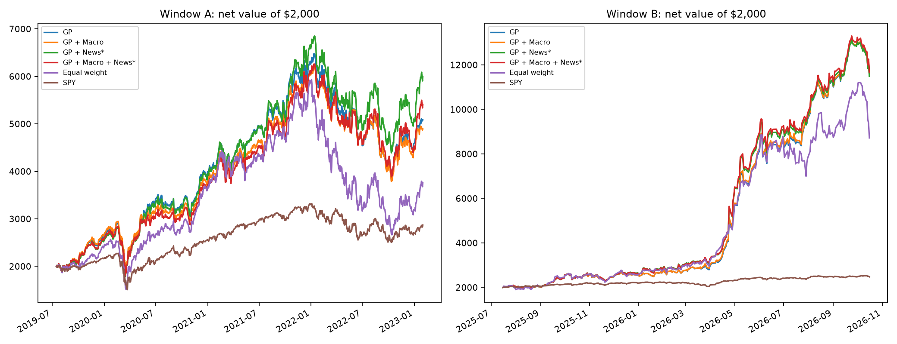
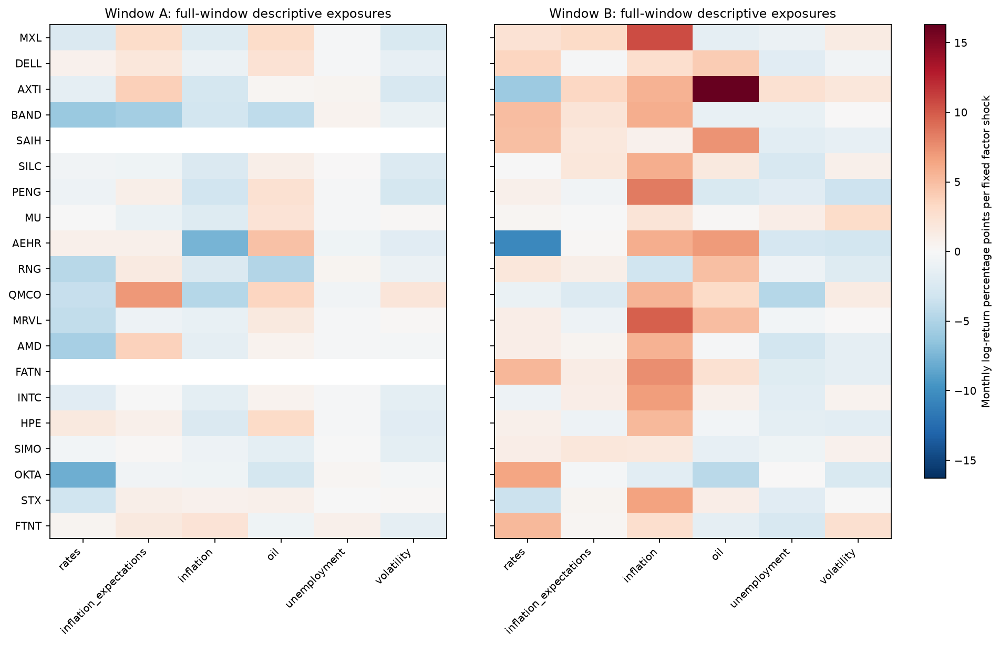
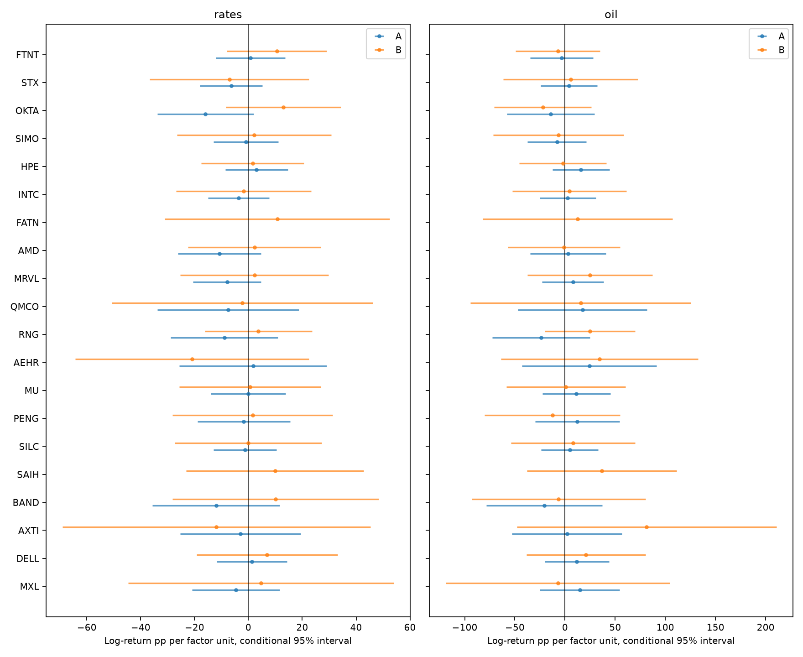
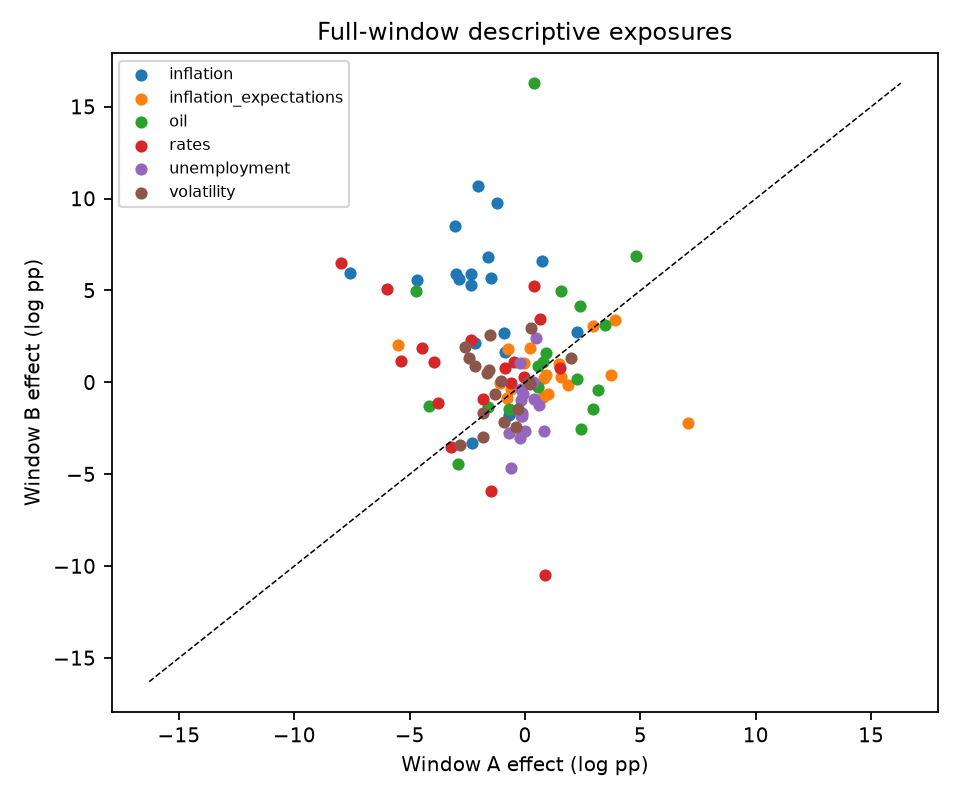
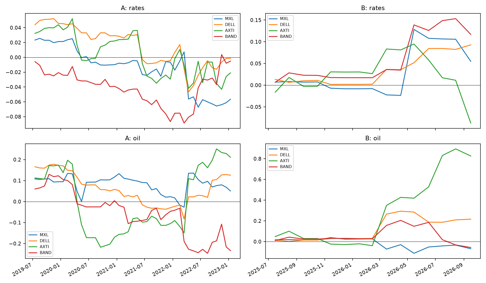
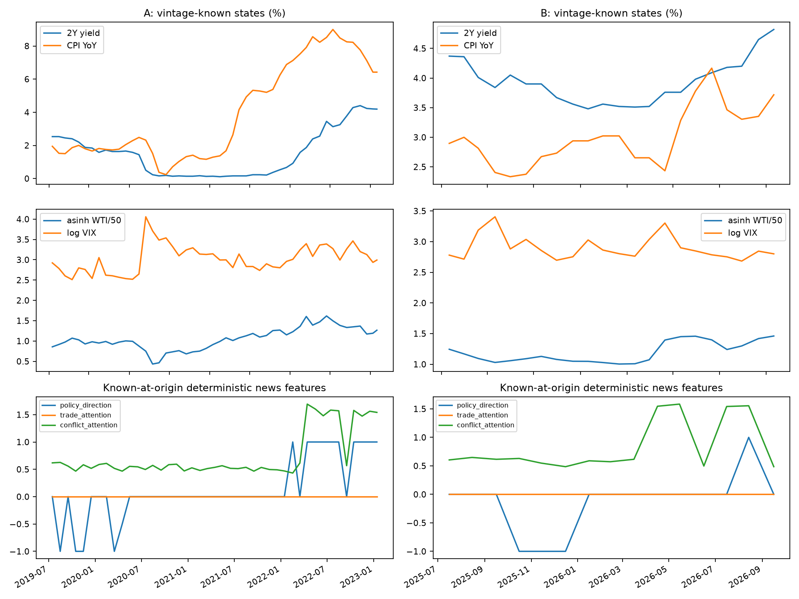
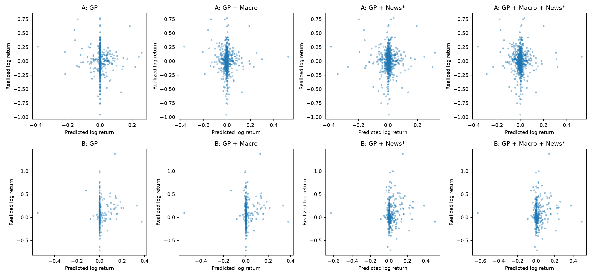
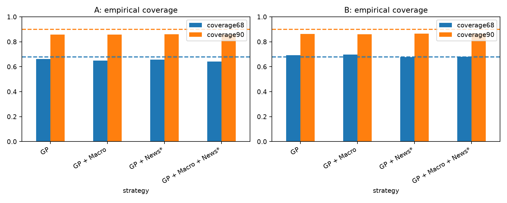
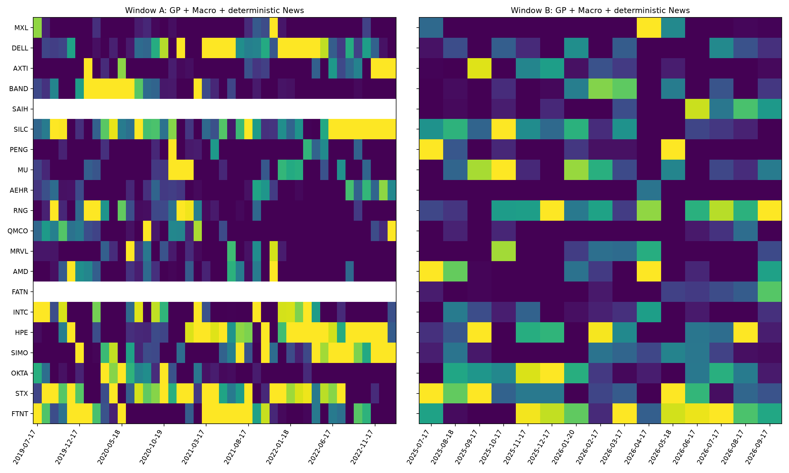
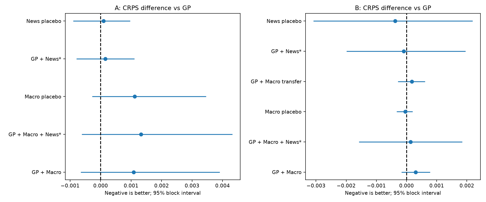
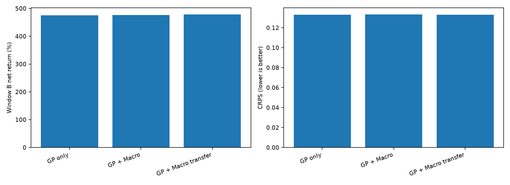

The exact universe is in `tickers.txt`; complete frozen settings are in `config.yaml`. Seed 20261019, 10,000 antithetic paths per joint forecast. `forecasts/gp_cache` checkpoints include ordered tickers, price/code fingerprints and fitted parameters. `forecasts/parameters.csv`, mapping caches, source snapshots, software versions and execution log make the run restartable. `logs/audit.json` checks chronology/constraints/fees; `logs/independent_audit.json` independently reconstructs every daily gross and net portfolio path, checks PSD and timestamps. Prior study output checksums are preserved in `logs/previous_study_hashes.json` and verified after execution.

```bash
.conda-env/bin/python scripts/prepare_growth20_study.py
MPLCONFIGDIR=/tmp/stocks-matplotlib-audit OPENBLAS_NUM_THREADS=1 .conda-env/bin/python -m pytest tests/test_growth20_study.py tests/test_macro_news.py tests/test_portfolio.py -q
MPLCONFIGDIR=/tmp/stocks-matplotlib-audit OPENBLAS_NUM_THREADS=1 .conda-env/bin/python scripts/run_macro_news_study.py --output experiments/portfolio_gp_macro_news_growth20_2026-10-19 --smoke
MPLCONFIGDIR=/tmp/stocks-matplotlib-audit OPENBLAS_NUM_THREADS=1 .conda-env/bin/python scripts/run_macro_news_study.py --output experiments/portfolio_gp_macro_news_growth20_2026-10-19
```

Completed scope: usable-window price audit, unchanged heteroskedastic GP, all four mean-information variants, placebos, partially available cross-regime priors, matched portfolio accounting, exposures/uncertainty, event studies, forecast calibration, plots and reports. Unavailable scope: a full-20 pre-2023 history, a full six-month initial FATN history, actual LLM classification, fully integrated macro/news uncertainty, point-in-time unbiased winner selection and genuine historical consensus-surprise data. None is fabricated. [Architecture](ARCHITECTURE.md) and [data sources](DATA_SOURCES.md) state the exact conventions and deviations.
