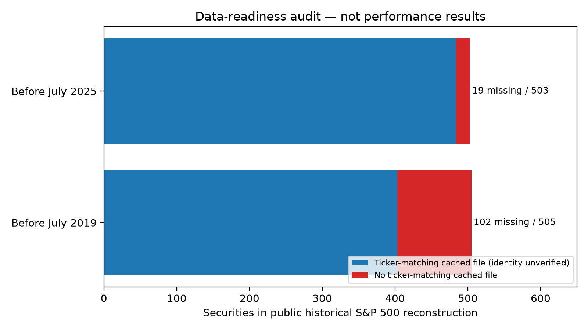

| window | group_name | planned | completed | GP win fraction | Median excess |
| --- | --- | --- | --- | --- | --- |
| A | Broad US market | 10 | 0 | Not estimable | Not estimable |
| A | Technology | 10 | 0 | Not estimable | Not estimable |
| A | Historical momentum top quintile | 10 | 0 | Not estimable | Not estimable |
| B | Broad US market | 10 | 0 | Not estimable | Not estimable |
| B | Technology | 10 | 0 | Not estimable | Not estimable |
| B | Historical momentum top quintile | 10 | 0 | Not estimable | Not estimable |

# Universe robustness study: execution blocked by historical-data gaps

**No scientific return results are available: 0/60 portfolio-window evaluations, 0 valid universe draws.** This is a data-readiness result, not a failed GP-performance result. Missing return/win-fraction fields in the CSVs are blank, not zero. Execution date (UTC): 2026-10-22; directory retains the requested study identifier.

## What was executed and observed

Inspected the growth20 experiment, its configuration, `stock_api/heteroskedastic.py`, `stock_api/portfolio.py`, shared monthly accounting, price ingestion and cache provenance. The original GP is reusable. The existing stock cache was sampled from **October 2026 IWB holdings**, with current-price restrictions, so it is not an admissible historical sampling universe. No macro/news models were run.

Downloaded a public historical S&P 500 membership reconstruction as a diagnostic and checked direct-symbol cache coverage before either selection date:

| window | selection_date | reconstructed_membership_date | members | direct_symbol_cached | not_cached | cached_253_prior_rows |
| --- | --- | --- | --- | --- | --- | --- |
| A | 2019-07-16 | 2019-07-15 | 505 | 403 | 102 | 399 |
| B | 2025-07-16 | 2025-07-09 | 503 | 484 | 19 | 484 |

These counts do **not** establish a verified broad-US universe. They measure exact-symbol cache presence only. Missing symbols include renamed firms and absent downloads as well as delisted companies; cached symbols can have issuer-identity ambiguity. The historical S&P reconstruction is a large-cap proxy, lacks historical sector fields and is not a complete US-listed security master. It was not silently substituted for the required universe. No selection or momentum ranking was restricted to the available files.

Provider/source probes:

- Historical iShares IWB AJAX URLs returned HTML rather than historical holdings. The `latest-holdings.csv?asOfDate=20190716` request returned **Fund Holdings as of,"Oct 20, 2026"**, not July 2019. Its response was rejected as a historical source, despite HTTP 200.
- The most recent `datasets/s-and-p-500-companies` commit on the queried path before July 2019 was **2018-04-02T20:58:25Z**, too stale to stand in for July 2019 sector/membership data. The analogous July 2025 snapshot was **2025-07-12T00:49:50Z**; this is useful partial historical information, but does not provide delisted prices, terminal payoffs or the all-US universe.
- Yahoo/yfinance probes of **CELG, ABMD, TWTR, SIVB** over June 2018–January 2023 each returned **zero rows** with `YFTzMissingError`. Thus even pre-selection historical observations can disappear when a security later delists. SIVB's disappearance after Window A does not justify dropping its earlier history. These probes were data checks, not outcome-selected study portfolios.
- The unauthenticated Sharadar SEP request returned **HTTP 429** (anonymous limit); no configured market-data credentials or local WRDS credential files were found. No successful licensed access was established. This does not prove no paid source exists; it establishes that the required data are unavailable in this environment.
- A **synthetic-only numerical smoke test** exercised the unchanged heteroskedastic GP on 20 generated return series with 10,000 paths, correlated covariance, allocation constraints, fees and all three stock benchmarks. Status: **PASS**. Generated inputs are test fixtures, not stock observations, and contribute zero experimental portfolio results. A representative historical portfolio cannot yet pass the data gate.

Source URLs, HTTP statuses, retrieval times, raw responses and SHA256 hashes are preserved under `data/source_audit/` and `logs/`. The current-cache historical-price convention also needs correction/validation before a historical $10 share-price filter: split-adjusted close is not automatically the actual price quoted at that historical date.

## Frozen design and implemented checks

Selection dates are July 16, 2019 and July 16, 2025, before next-day execution. Ten draws per group use independent reproducible seed streams; no within-portfolio duplicate issuer; overlap across portfolios allowed. Broad quotas total 20 exactly. Eligibility: historical raw price >$10, median 63-session dollar volume ≥$10 million, and 253 prior observations so all portfolios support the momentum benchmark. 12–2 momentum is log(P[t−21]/P[t−252]); top ceil(20% × eligible N) forms Group C. Known listing dates can exclude short-history IPOs; unobserved history fails the pool instead of filtering survivors. Share-class choice uses historical liquidity only.

The GP remains estimated drift, unchanged kernels/priors, 30-session **lookback**, 10,000 paths, lambda 10, cap 20%, $2,000 and 10 bp per dollar bought/sold. The task mentions a 30-session forecast horizon, but the prior implementation actually forecasts the exact monthly holding sessions; preserving that implementation avoids an unannounced model change. Equal weight, 63-session inverse volatility and positive cross-sectional momentum-rank weights share capped allocations and the same trading rules. SPY is exempt from the stock cap. Corporate-action losses/proceeds cannot be silently replaced by flat prices or skipped names.

`stock_api/universe_robustness.py` implements strict eligibility, sector/random sampling, capped benchmark mapping and synchronized paired block uncertainty. The sampler was tested for all 60 planned IDs using clearly synthetic candidates. Additional tests cover future-data invariance, unavailable-history rejection, quota/cap compliance, and preservation of uncertainty when an identical portfolio is repeated 30 times. Duplicating a portfolio must not manufacture 30 independent observations.

Planned inference: shared three-month circular blocks across all portfolios/groups/benchmarks in each historical window, 2,000 replicates. Portfolio-overlap and common market shocks stay paired. Cross-universe dispersion is distinct from temporal uncertainty; only two historical regimes exist. Bootstrap intervals condition on observed weights and are not full strategy-refitting confidence guarantees. Neither this design nor partial data availability warrants a claim of complete elimination of survivorship bias.

## Scientific questions: current answers

1. **Majority of universes beating equal weight:** not estimable. GP win fractions against equal weight, inverse volatility, momentum and SPY are all **N/A (0 evaluated)**.
2. **Consistency across broad, technology and momentum groups:** not tested; all six group/window cells are blocked.
3. **Risk-adjusted versus absolute-return benefit:** not tested. No Sharpe, drawdown, volatility or transaction-cost improvement is inferred from missing results.
4. **Persistence across regimes:** not tested. Two windows cannot be replaced with successful contemporary survivors.
5. **Comparison with the hindsight growth universe:** its prior reported gains remain a biased reference, not evidence of universe robustness. No new Monte Carlo point is available to compare with it. The original files remain unchanged.
6. **Predictive calibration:** not evaluated on the requested random portfolios. Synthetic GP smoke-test validity is not empirical forecast calibration.
7. **Exceptional stocks, portfolios or months driving gains:** unassessed because no study portfolios were evaluated. Dropping missing names would itself condition results on survival/data availability.
8. **Economically meaningful net advantage after costs:** unassessed. Fees and cap logic passed software checks, but these do not establish financial efficacy.

**Assessment: this study has not demonstrated robust GP allocation value independent of retrospective selection.** It also has not demonstrated absence of value; the required test remains unperformed because its historical inputs are incomplete. Running 60 survivor-filtered backtests would produce numbers without answering the stated question.

## Sources and precise path to completion

- [Historical membership reconstruction](https://github.com/fja05680/sp500): versioned raw snapshot cached, membership-only diagnostic with documented reconstruction limitations. [Dated constituent snapshots](https://github.com/datasets/s-and-p-500-companies) were fetched at explicit commits; current rows were never treated as historical.
- [CRSP database documentation](https://www.crsp.org/research/crsp-us-stock-databases/) and [permanent identifiers](https://www.crsp.org/research/permno/) describe historical security tracking. [CRSP delisting definitions](https://www.crsp.org/crsp_pdf/crsp-us-stock-indexes-databases-data-descriptions-guide-crspaccess/) distinguish terminal returns from ordinary last-price observations. Access plus historical sector classifications is needed, not merely a ticker list.
- [Norgate data contents](https://norgatedata.com/data-content-tables.php) documents historical constituent and delisted-security coverage; [accessibility](https://norgatedata.com/accessibility.php) documents its integrations. A licensed export is a possible route on this Mac, but historical sector availability and terminal accounting still require verification. No subscription was purchased.
- [Sharadar SEP documentation](https://data.nasdaq.com/databases/SEP/documentation?anchor=sample-data) describes active/delisted price coverage. The observed unauthenticated API request was not usable; sector/identifier/terminal data cannot be inferred from the SEP name alone.

Resolve [DATA_REQUIREMENTS.md](DATA_REQUIREMENTS.md): provide historical security/sector membership and identity maps, pre-selection raw prices/volumes and total returns for the full candidate pool, and complete evaluation paths/corporate-action settlements for sampled securities. Then implement and validate the provider/lifecycle adapter, freeze all draws, run a representative historical smoke test, and execute the 60 evaluations with per-portfolio checkpoints. The 1,740 joint monthly forecasts represent about 34,800 univariate fits without deduplication; computation is not the current blocker. No model simplification is proposed.

Audit-resume and test commands are in [README.md](README.md). They do not claim to be a finished backtest executor: provider normalization, terminal-event accounting, full portfolio execution and the five requested performance figures remain outstanding. `portfolio_results.csv` and `forecast_calibration.csv` contain explicitly blocked planned slots; `universes.csv` is intentionally empty. No outcomes, plot distributions, delisting values or win fractions have been invented.
