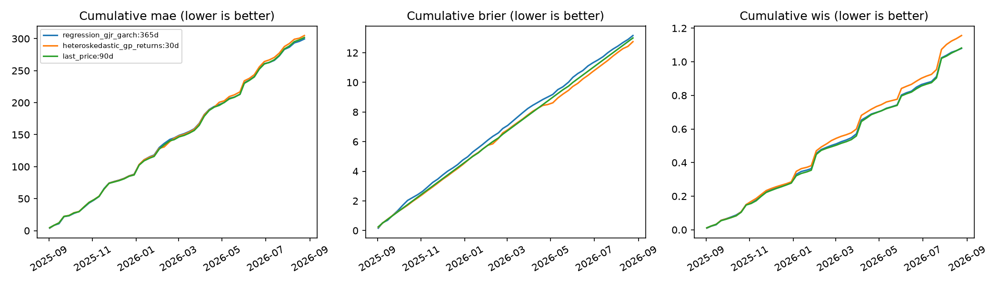

# Regression–GJR-GARCH versus the saved Amazon GP forecasts

Period: September 2025–August 2026. 52 weekly origins, 2025-09-02–2026-08-24, with the original seven-calendar-day horizon. This is a retrospective development comparison, not an untouched test set.

## Model and fixed comparison design

The new model jointly estimates an intercept and AR(1) regression on daily Amazon log returns, with GJR-GARCH(1,1) conditional variance and standardized Student-t innovations. No GOOGL/AAPL, market index, or other external predictors enter this comparison. The lower-level API supports additional explicitly aligned regressors and future regressor scenarios. This benchmark tests the autoregressive version; it cannot measure the value of future external data.

The **primary choice was fixed before fitting: GJR with 365 calendar days of history versus the archived 30-calendar-day heteroskedastic GP**, the previously identified reliable GP setting. This is a comparison of practical configurations with different training lengths and inference, not a controlled model-family comparison. GJR 60/90/180-day windows provide same-history comparisons against the saved GP; 730 days is a longer-history sensitivity. GJR requires at least 31 daily returns, so the 30-calendar-day window is not estimated. These are calendar-day windows, not the public API's trading-session lookback.

Both use 2,000 predictive paths. GJR forecasts condition on jointly estimated maximum-likelihood parameters; the archived GP integrates hyperparameter and latent uncertainty using MCMC. Every future GJR path recursively updates its lagged return, residual sign, and variance. No Gaussian approximation or square-root-of-time interval scaling is used. Price means and standard deviations are omitted because exponentiated Student-t log returns do not have finite population moments; forecast medians and quantiles remain usable.

The immutable original price snapshot and GP predictions are reused. GP fits were not rerun, and the existing September 2026 archive was not modified. The new experiment has separate source/environment fingerprints and checkpoints. `5614a065f05adaed7df18faf74f1a1ade732fa8d79bf7b75849c8e290c5f8511` identifies the original price CSV. [Input-record provenance](comparison-provenance.json) links every score to its checksummed record.

## Results

All aggregate rows below use their own successful fits. Read failure counts before comparing rows; the paired tests below use only matching successful dates. MAE is the equal-origin mean of daily median-price errors. Terminal MAE and WIS use log-return percentage points. Coverage is terminal 95% coverage, not simultaneous path coverage. Smaller MAE, Brier and WIS are better.

| variant | successful | failed | MAE $ | NMAE % | Terminal MAE log pp | brier | 95% coverage % | WIS log pp |
| --- | --- | --- | --- | --- | --- | --- | --- | --- |
| regression_gjr_garch:60d | 52 | 0 | 6.7088 | 2.8413 | 4.2055 | 0.2996 | 86.5385 | 2.4534 |
| regression_gjr_garch:90d | 52 | 0 | 6.1608 | 2.6171 | 3.8714 | 0.2697 | 86.5385 | 2.3044 |
| regression_gjr_garch:180d | 52 | 0 | 5.8432 | 2.4903 | 3.6750 | 0.2541 | 90.3846 | 2.1251 |
| regression_gjr_garch:365d | 52 | 0 | 5.7594 | 2.4564 | 3.6627 | 0.2532 | 88.4615 | 2.0763 |
| regression_gjr_garch:730d | 52 | 0 | 5.8635 | 2.4969 | 3.7369 | 0.2588 | 88.4615 | 2.0649 |
| heteroskedastic_gp_returns:30d | 52 | 0 | 5.8633 | 2.4943 | 3.6364 | 0.2452 | 90.3846 | 2.2237 |
| heteroskedastic_gp_returns:60d | 51 | 1 | 5.7765 | 2.4661 | 3.5968 | 0.2485 | 88.2353 | 2.1468 |
| heteroskedastic_gp_returns:90d | 44 | 8 | 5.7794 | 2.4746 | 3.7587 | 0.2474 | 90.9091 | 2.1468 |
| heteroskedastic_gp_returns:180d | 24 | 28 | 6.6385 | 2.8020 | 4.3829 | 0.2498 | 83.3333 | 2.4623 |
| last_price:90d | 52 | 0 | 5.8025 | 2.4698 | 3.6595 | 0.2500 | 92.3077 | 2.0809 |

## Primary paired comparison

Differences are **GJR minus GP**, so negative favors GJR. All values in this table retain raw units: dollars for MAE, dimensionless log returns for terminal MAE/WIS, and probability-squared for Brier. Confidence intervals are marginal eight-week circular moving-block bootstrap intervals, not simultaneous intervals. Holm p-values cover all 100 planned contrasts (five GJR windows × five references × four losses). An interval spanning zero does not support a directional conclusion. Comparisons with fewer than 20 successful pairs have no inferential interval.

| loss | paired_origins | candidate_mean | reference_mean | mean_loss_difference | lower95 | upper95 | holm_p_value |
| --- | --- | --- | --- | --- | --- | --- | --- |
| mae | 52 | 5.759413 | 5.863302 | -0.103889 | -0.300969 | 0.093163 | 1.000000 |
| terminal_return_mae | 52 | 0.036627 | 0.036364 | 0.000263 | -0.001284 | 0.001854 | 1.000000 |
| brier | 52 | 0.253172 | 0.245197 | 0.007975 | -0.005878 | 0.021343 | 1.000000 |
| wis | 52 | 0.020763 | 0.022237 | -0.001474 | -0.002630 | -0.000600 | 0.424788 |



## Limits and operational interpretation

Fitting errors are preserved as failures without fallback or outcome-driven retuning. GP convergence failures remain excluded exactly as in the saved experiment. Check [per-origin scores](scores.csv) for failure reasons, training sizes, fitted variance persistence and Student-t degrees of freedom. A numerically successful GARCH fit can still sit near a parameter boundary; optimizer convergence is not evidence that parameters are well identified. The 60/90-day fits are particularly short for estimating both regression and volatility.

The held-out outcomes here were already inspected in earlier repository analyses. The period has roughly one year of weekly episodes, with holiday-related overlap; it cannot establish long-run generalization. Simulation error remains, particularly in tail estimates. The point, probability and interval metrics should be assessed separately, and differences in parameter uncertainty and training history should not be attributed solely to the choice of GARCH versus GP.

Full [summary](summary.csv), [paired comparisons](paired-comparisons.csv), and [frozen comparison configuration](comparison-config.json) are included. Reproduce/resume without downloading:

```bash
MPLCONFIGDIR=/tmp/stocks-matplotlib-audit OPENBLAS_NUM_THREADS=1 .conda-env/bin/python examples/gjr_amzn_comparison.py
```
