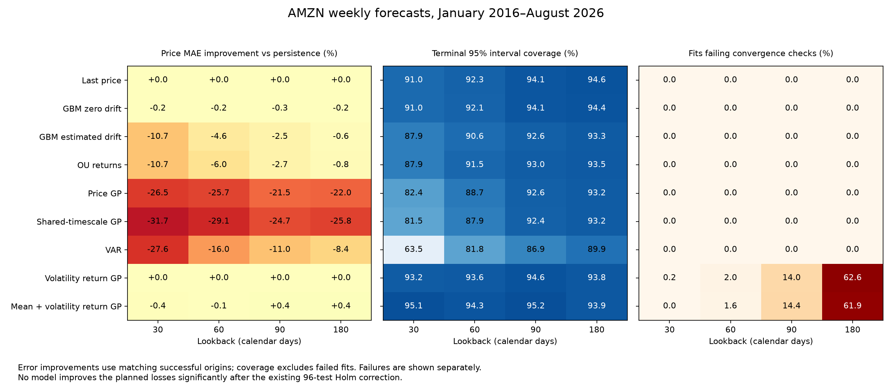

# Amazon historical-data and forecasting review

Review date: October 17, 2026. Primary evidence: the saved [2016–2026 AMZN experiment](../historical_validation/AMZN/2016-2026-v1/index.html).

## Recommendation

**Use the frozen historical-data pipeline for research and `last_price` (persistence) as the forecasting default.** Among the implementations evaluated here, added model complexity has not established a reliable improvement in weekly Amazon price or direction forecasts. None of the 96 planned comparisons improves on persistence at a 5% significance level after the repository's multiple-comparison correction; 38 show deterioration.

For uncertainty estimates, **90 calendar days is a reasonable provisional persistence lookback**: it has the lowest overall weighted interval score among configurations that successfully forecast every origin. The 180-day window has terminal 95% coverage closer to nominal, but slightly worse interval scores. Both produce exactly the same point forecast—the latest observed close. Choosing between their uncertainty estimates is a development decision, not a validated out-of-sample optimum.

The mean-and-volatility return GP is a research candidate for uncertainty modeling, not a demonstrated forecasting upgrade. Its 30-day version completes every fit and attains 95.14% terminal coverage, but has slightly worse point and interval scores than persistence. Its longer-window versions suffer substantial convergence failures.

### Best choices when persistence is excluded

A bare last-price point forecast does not specify uncertainty. In this repository, however, `last_price` maps to `random_walk`, which additionally estimates daily log-return variance and multiplies it by the forecast step. The intervals discussed above belong to that attached random-walk model, not to persistence as a point-forecast rule.

Among the remaining implementations, the practical shortlist is:

| Purpose | Model and calendar-day lookback | Price MAE | Brier | Terminal 95% coverage | Successful fits |
|---|---|---:|---:|---:|---:|
| Simple, inexpensive predictive distribution | `gbm_zero_drift`, 90 days | $2.9778 | 0.2511 | 94.06% | 556/556 |
| Learned mean and volatility; strongest complete-run directional probability score | `heteroskedastic_gp_returns`, 30 days | $2.9821 | 0.2483 | 95.14% | 556/556 |
| Inexpensive estimated drift | `gbm_estimated_drift`, 180 days | $2.9891 | 0.2494 | 93.35% | 556/556 |
| Alternative return dynamics | `ou_returns`, 180 days | $2.9951 | 0.2493 | 93.53% | 556/556 |

**Choose zero-drift GBM at 90 days for a simple distribution forecast, or the 30-day mean-and-volatility GP if learning both components is the objective.** Zero-drift GBM at 90 days has the best WIS among non-persistence configurations with no failures (0.017442); its point accuracy is virtually identical across lookbacks. The 30-day mean-and-volatility GP has the best Brier score among those complete-run configurations, with coverage closest to 95%, but costs much more and has worse WIS (0.017915). These are descriptive rankings, not demonstrated statistically significant differences between the shortlisted methods: the existing planned tests compare each method with persistence.

The volatility-only return GP at 60 days is also a reasonable volatility research candidate: its matched WIS is slightly better than zero-drift GBM on the 541 common successful origins, but it fails 11/556 fits and fixes P(up) at 0.5. At 90 days, the mean-and-volatility GP has the best price MAE among the other models on the 453 common successful origins, but its 80/556 failures make it a less reliable default. Do not prefer 180-day return-GP results without accounting for their roughly 62% failure rates. Price GPs, the shared-timescale GP, and VAR are outside the leading group on this evidence.



## What was inspected and verified

I read the download, forecasting, validation, historical-runner, inference, and scoring code, together with the saved benchmarks. The main experiment has **556 weekly origins × four lookbacks × nine models = 20,016 attempted fits**, of which **19,145 succeeded and 871 failed inference checks**. There are no pending fits or recorded data failures. The saved completion heartbeat is September 21, 2026; statements in [HISTORICAL_VALIDATION.md](../HISTORICAL_VALIDATION.md) that the run has not started are stale.

The offline audit verified every record's checksum, experiment/configuration identity, deterministic seed, training and forecast dates, training-data checksum, starting price, and realized prices/terminal return against the frozen snapshot. It recomputed the saved numerical per-origin scores and all 96 planned bootstrap comparisons, including their Holm corrections. The inference and reporting source hashes still match the experiment manifests. This establishes internal consistency, not independent confirmation of every Yahoo quote or proof of statistical-model correctness.

The focused historical and download-alignment tests passed: **23 tests**. Dependency deprecation warnings remain. No prices were downloaded again, no models were refitted, and the original results were preserved. [Audit evidence](amzn-review/audit.json) and the [reproduction script](../scripts/audit_amzn_history.py) accompany this report.

## Historical-data download

All implemented download paths use Yahoo through `yfinance`; this repository does not contain a comparison of independent market-data vendors.

| Implemented path | Behavior | Appropriate use |
|---|---|---|
| [`utils.get_stock_data`](../utils.py) | Downloads each ticker with a relative period/interval; does not explicitly freeze adjustment settings, validate exchange sessions, or preserve a research snapshot | Original exploratory examples |
| [`stock_api.data.load_prices`](../stock_api/data.py) | Explicit daily adjusted closes, 15-second timeout, completed-session alignment, positive/finite-price validation; rejects incomplete shared history | Live predictions and the older validation runner |
| [`historical.runner.download/prepare`](../stock_api/historical/runner.py) | Fixed date range and tickers, adjusted closes, 30-second timeout; freezes a checksummed snapshot, configuration, package versions and source hashes; resume reuses that snapshot | **Best implemented path for reproducible historical comparisons** |

The historical download requests AMZN, GOOGL, and AAPL together with `auto_adjust=True`, `threads=False`, and an exclusive end date of September 1, 2026. It extracts `Close`, aligns to XNYS sessions, and preserves invalid/missing observations as missing rather than filling them. Daily interval is the library default in this path; the live loader explicitly sets `interval="1d"`. The documented downloader semantics confirm that `end` is exclusive and that automatic adjustment applies to prices. [yfinance download reference](https://ranaroussi.github.io/yfinance/reference/api/yfinance.download.html).

The frozen snapshot was created September 12, 2026, using recorded `yfinance` version 0.2.66. It contains **2,815 unique, ordered exchange-session rows, June 22, 2015–August 31, 2026**, with three complete, finite, positive price series. Earlier dates provide training history for the first 2016 forecasts. Its SHA-256 is `5614a065f05adaed7df18faf74f1a1ade732fa8d79bf7b75849c8e290c5f8511`.

Amazon's 20-for-1 split is an important sanity check. Amazon documents the split as effective June 3, 2022. The snapshot's adjusted close is $122.3500 on June 3 and $124.7900 on June 6, a normal-sized increase of about 1.99%, not a mechanical twentyfold discontinuity. This supports correct split handling at that boundary; it is not an exhaustive corporate-action audit. [Amazon investor FAQ](https://ir.aboutamazon.com/faqs/default.aspx).

Data limitations and worthwhile improvements:

- These are **retrospectively adjusted prices**, downloaded after the forecast dates. Timestamp isolation is sound, but the snapshot cannot establish which exact provider revisions were available on each historical date.
- Only adjusted closes are frozen. Saving the original provider response, raw/adjusted fields, corporate actions, explicit request settings, and retrieval metadata would make provider-level auditing stronger. Log any repairs separately rather than silently changing the research snapshot.
- There is no application-level retry/backoff around the historical download. An entirely empty response stops the run; missing observations in a partially returned series can become frozen missing data and fail affected units. A retry and quality-review stage before freezing would improve resilience.
- XNYS session alignment is suitable for this configured US-equity experiment. The supplied snapshot exactly matches that calendar; zero missing rows does not by itself prove all quotes are accurate.

## Evaluation methodology

The weekly forecast origin is before the opening of the first exchange session of the week. Training dates are strictly earlier; targets lie in `[origin, origin + 7 calendar days)`. The actual origins run **January 4, 2016–August 24, 2026**. Each complete model/lookback has 556 terminal outcomes and 2,731 scored path observations, with some holiday-induced overlap between episodes. These are not 2,731 independent forecasts.

The historical lookbacks are **calendar days**, unlike the public prediction API's trading-session lookback. Their observed training sizes are:

| Calendar-day lookback | Trading observations, minimum–maximum | Median |
|---|---:|---:|
| 30 | 17–20 | 19 |
| 60 | 37–42 | 41 |
| 90 | 58–63 | 62 |
| 180 | 120–126 | 123 |

Do not translate the recommendation into `predict(..., lookback=90)` and assume it reproduces the historical 90-calendar-day window.

The price GPs use nested sampling of hyperparameters; return GPs use joint latent MCMC with four chains, 1,500 warmup iterations and 5,000 retained draws per chain. Forecasts use 2,000 predictive paths. Non-GP models retain their plug-in parameter estimates. This is not the same inference regime as the ordinary API's default GP optimizer or the older benchmark's variational return-GP fits.

Metrics should be read separately:

- Price MAE scores the predicted median at each horizon date, then averages equally over origins. Normalized MAE and terminal log-return error are useful across a decade of changing stock prices.
- Brier score evaluates the terminal up/down probability; smaller is better. Persistence always gives 0.5 and scores 0.25. It abstains on directional point predictions.
- Main coverage is **terminal-return interval coverage**, not simultaneous path coverage. The older benchmark emphasizes pointwise path coverage, so its percentages cannot be compared directly.
- Paired comparisons use the same successful origins for model and baseline, an eight-week moving-block bootstrap, 2,000 replicates, and Holm adjustment over all 96 planned tests. The bootstrap accounts for serial dependence approximately. Failed fits remain excluded, so those comparisons describe performance conditional on success.

No untouched holdout was designated. The entire inspected interval is now development evidence.

## Which models performed best?

The table gives **percentage improvement in price MAE relative to persistence on matching successful origins**. Positive is better; negative is worse. The full metric table, including each matched baseline and sample size, is in [comparison.csv](amzn-review/comparison.csv).

| Model | 30 days | 60 days | 90 days | 180 days |
|---|---:|---:|---:|---:|
| `last_price` | 0.00% | 0.00% | 0.00% | 0.00% |
| `gbm_zero_drift` | −0.24% | −0.24% | −0.27% | −0.25% |
| `gbm_estimated_drift` | −10.74% | −4.62% | −2.48% | −0.65% |
| `ou_returns` | −10.74% | −6.03% | −2.73% | −0.85% |
| `gp` | −26.54% | −25.70% | −21.52% | −21.96% |
| `multitask_gp` | −31.71% | −29.12% | −24.72% | −25.81% |
| `var` | −27.64% | −15.97% | −11.00% | −8.40% |
| `volatility_gp_returns` | 0.00% | 0.00% | 0.00% | 0.00% |
| `heteroskedastic_gp_returns` | −0.41% | −0.06% | +0.44% | +0.38% |

Persistence's full-period MAE is **$2.96984**, normalized MAE **2.29817%**, and terminal absolute log-return error **3.20098 log percentage points**. Its point errors are identical across lookbacks; only uncertainty changes. The volatility-only return GP also predicts the same median by construction, so its different unpaired aggregate errors reflect different successful dates, not a different point predictor.

The small favorable mean-and-volatility GP numbers do not establish superiority. At 90 days, its paired price-MAE difference is −$0.01309, with a bootstrap 95% interval of **[−$0.03304, +$0.00710]**. At 30 days, its Brier score is 0.24826 versus 0.25, but the difference's interval is **[−0.00514, +0.00132]**. Both span zero and have Holm-adjusted p-values of 1.0. At 180 days, its matched terminal-return error and Brier score are slightly worse than persistence.

Price GP and shared-timescale GP deterioration is significant for all three planned losses at every lookback under the existing correction. The 90-day price GP has worse price MAE, terminal error, and Brier score in **every one of the 11 calendar-year groups**. The `multitask_gp` implementation shares a length scale between otherwise independent ticker GPs; it is not a general cross-stock covariance or causal model. Adding GOOGL/AAPL through that construction did not help here. VAR also has worse mean price MAE at every lookback.

OU's label needs care: it falls back to IID Gaussian returns in **100% of 30-day fits** and about **55–61%** of longer-window fits. Its shortest window has fewer than 20 returns, so its scores equal estimated-drift GBM. These results do not demonstrate a successful mean-reverting process for Amazon returns.

## Reliability and failed inference

All 871 failures are in the return GPs and are recorded as `inference_failed`. The checks require maximum split R-hat below 1.05 and minimum autocorrelation effective sample size above 100. Failed predictions are preserved but excluded from scores.

| Model | 30-day failures | 60-day failures | 90-day failures | 180-day failures |
|---|---:|---:|---:|---:|
| Volatility return GP | 1 / 556 | 11 / 556 | 78 / 556 | 348 / 556 |
| Mean-and-volatility return GP | 0 / 556 | 9 / 556 | 80 / 556 | 344 / 556 |
| Each other model | 0 / 556 | 0 / 556 | 0 / 556 | 0 / 556 |

The 180-day return-GP failure rates are **62.59% and 61.87%**. Their remaining 208/212 forecasts cannot be ranked against another model's full 556 without matching dates. Restricting to dates where all nine models succeeded leaves **555, 541, 453, and 165 origins** at the four lookbacks. Those common panels are saved in [common-origins.csv](amzn-review/common-origins.csv); they still condition on potentially selective convergence.

As a separate, explicitly post-hoc sensitivity check, replacing a failed forecast with persistence gives the 90-day mean-and-volatility GP MAE **$2.95864**, only about **0.38%** better than persistence across all dates. Its Brier score becomes 0.24904. This policy is not currently implemented, and these descriptive results are not a fresh significance test. [Failure-replacement results](amzn-review/persistence-on-failure.csv).

Compute cost is substantial: stored unit runtimes sum to **241.70 hours**, with **225.85 hours** in the two return-GP families. These are summed unit times, not an uninterrupted wall-clock duration. Median fit times at 30 days are about **31 seconds** for the volatility GP and **77 seconds** for the mean-and-volatility GP, versus about **0.0025 seconds** for persistence; download time is excluded. At 180 days those GP medians rise to about **244 and 630 seconds**. The mean component is classified inactive by the repository's diagnostic in every successful mean-and-volatility GP fit; this does not prove an exactly zero mean, but cautions against interpreting its fitted length as an identified predictive cycle.

## Uncertainty: coverage alone is insufficient

I additionally computed a **weighted interval score (WIS)** from the saved terminal log-return median and central 50%, 68%, 90%, and 95% intervals. It rewards narrow useful intervals and penalizes misses. For central interval `[l,u]` with tail probability `alpha`, the interval score is `u-l + 2/alpha * (max(l-y,0) + max(y-u,0))`; WIS averages the median error with weight 0.5 and the four interval scores with weights `alpha/2`, dividing by 4.5. Smaller is better. This is a post-hoc comparison, separate from the original 96 tests. [Scoring-rule reference](https://journals.plos.org/ploscompbiol/article?id=10.1371/journal.pcbi.1008618).

| Configuration | Successful origins | Terminal 95% coverage | Mean 95% width, log pp | WIS, log pp |
|---|---:|---:|---:|---:|
| Persistence, 30 days | 556 | 91.01% | 16.47 | 1.7687 |
| Persistence, 60 days | 556 | 92.27% | 16.89 | 1.7584 |
| Persistence, 90 days | 556 | 94.06% | 17.02 | **1.7404** |
| Persistence, 180 days | 556 | 94.60% | 17.27 | 1.7457 |
| Mean-and-volatility GP, 30 days | 556 | 95.14% | 20.70 | 1.7915 |

The 30-day mean-and-volatility GP's interval is about **25.7% wider** than persistence at the same lookback and has **1.29% worse WIS**. It has 2.94% worse WIS than 90-day persistence. Near-nominal 95% coverage alone therefore does not justify switching models. Other return-GP interval-score gains on successful subsets are small and do not settle the convergence-selection problem.

Nor does an aggregate coverage number guarantee reliability in each period. Persistence at 180 days covers **90.57% in 2018** and **85.29% in the partial 2026 year**. The 30-day mean-and-volatility GP also covers only 85.29% in 2026. Persistence's 90-day central 50%/68% intervals cover 53.78%/72.30%, so even the provisional choice is not perfectly calibrated at all levels. [Annual results](amzn-review/yearly.csv).

Directional probabilities are also unproven: 55.94% of terminal outcomes are positive, while persistence predicts 50%. Its Brier score of 0.25 is a useful null, not proof of calibration. A constant probability estimated using all realized outcomes would leak future information; a training-only base-rate forecast would be a worthwhile future comparator, but it is not one of the evaluated implementations.

## Reconciling the earlier Amazon benchmark

The [earlier return-GP report](../validation_runs/return-gp-2026-09-01-benchmarks/REPORT.md) uses only **12 monthly origins and 56 path prices**, versus 556 weekly origins here. It reports a 6.07% price-MAE improvement for the 30-day mean-and-volatility GP, concentrated in the May 2026 fold. That result does not persist in the broader posterior-sampling run: the corresponding model has 0.41% worse mean price MAE here.

These experiments differ in dates, origin rules, inference, priors, simulation size, and—for the older price GPs—calendar-day versus trading-session time coordinates. They are not a controlled test of optimizer versus posterior inference. AMZN prices match exactly over their 359 overlapping snapshot dates, so an obvious Amazon snapshot discrepancy does not explain their disagreement. The longer run is the more informative evidence for the tested historical setup; it does not prove all possible implementations of these model families would fail.

## Next methodology to use

1. **Keep the historical snapshot/checkpoint workflow.** Preserve versioned datasets and code fingerprints; add provider-response and corporate-action provenance for the next dataset.
2. **Use persistence as the reference and provisional default.** Use the historical 90-day window for a balanced interval-score choice; retain 180 days as a sensitivity alternative. Declare the scoring objective before further comparisons.
3. **Reserve a genuinely uninspected future period.** Freeze the candidate, lookback, inference budget, convergence criteria, and any fallback policy before evaluating it. Use terminal log-return or normalized losses alongside probability/interval scores, not only dollar errors.
4. **Treat failed forecasts as part of operational performance.** Report availability and cost alongside matched-origin accuracy. Any fallback should be specified prospectively. Additional sampler tuning belongs in a new experiment rather than retroactive replacement of failed records.
5. **Do not infer trading profitability from this benchmark.** It evaluates forecast distributions and medians, without a trading rule, execution costs, or portfolio outcomes.

Reproduce this review's data audit and derived tables from the repository root:

```bash
MPLCONFIGDIR=/tmp/stocks-matplotlib-audit .conda-env/bin/python scripts/audit_amzn_history.py
```

The script writes only to `reports/amzn-review/` by default. It reads the frozen original records and performs no download or forecast fit. The original [overall metrics](../historical_validation/AMZN/2016-2026-v1/summaries/overall.csv), [paired tests](../historical_validation/AMZN/2016-2026-v1/summaries/paired-comparisons.csv), and [browsable report index](../historical_validation/AMZN/2016-2026-v1/index.html) remain the source evidence.
