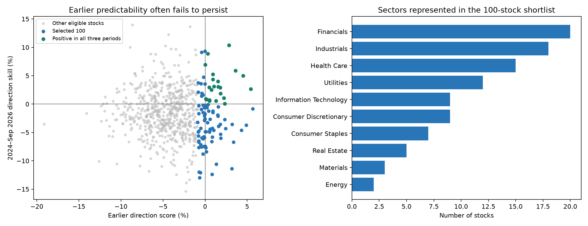

# Monthly stock predictability: 100-stock research shortlist

Prepared October 18, 2026. Latest stock closes: **October 16, 2026**. Last completed return month: **September 2026**. Scope: US-listed stocks in the issuer-published Russell 1000 ETF holdings, with prices strictly above $10.

## Finding and recommendation

I assembled and tested **100 ranked research candidates**, but the evidence does **not identify 100 stocks with demonstrated, persistent monthly directional predictability**. Out of 686 eligible issuers, only 59 of the selected 100 beat the direction baseline in both earlier selection periods; 22 also beat it in the later 2024–September 2026 audit. None survives correction for the number of stocks tested. The full list is provided below, with negative results retained rather than replacing unsuccessful stocks after seeing the later outcomes.

For portfolio research, start with the **22 positive-skill names** listed below and retain the full 100 as the comparison universe. These are candidates for further testing, not confirmed investment signals. The evidence is stronger for anticipating the **size of fluctuations** than their direction: on the selected stocks, the simple monthly volatility model reduces squared log-variance error by 6.4% relative to its historical-average baseline, whereas the direction model is worse than its baseline. Predictable volatility can help determine position sizes; it does not establish positive expected returns.

**Price requirement:** all 100 have independently downloaded latest closes above $10 and issuer-reported prices above $10. The lowest selected close is **$14.47** (CAG); the smallest selected median daily dollar volume is **$34.3 million**. This is a liquid listed-equity screen, with funds, cash and derivatives excluded. Prices can subsequently fall through the threshold, so it must be reapplied before portfolio formation.

## Where the information came from

1. **Universe, company names, sectors and an initial price check:** [iShares Russell 1000 ETF holdings](https://www.ishares.com/us/products/239707/ishares-russell-1000-etf/latest-holdings.csv), dated **October 15, 2026**, downloaded from the fund issuer. The [fund page](https://www.ishares.com/us/products/239707/ishares-russell-1000-etf) describes its US large- and mid-cap exposure. The saved [raw holdings](data/iwb-holdings.csv) preserve the exact vintage used; this is a practical broad universe, not every exchange-listed stock or an independently reconstructed Russell membership database.
2. **Latest closes, daily volume, adjusted historical prices and corporate-action fields:** Yahoo Finance, downloaded with the repository's existing [yfinance history API](https://ranaroussi.github.io/yfinance/reference/api/yfinance.Ticker.history.html). Histories were requested for January 2009–October 16, 2026. Each ticker in the table links to its Yahoo history page. Raw histories and retrieval timestamps/checksums are saved in `data/`; the combined [provenance file](data-provenance.json) lists evaluated input files. Screening uses the latest `Close`; return calculations use `Adj Close`, so historical price adjustments do not turn today's $10 filter into a historical-price filter.
3. **Predictor rationale:** the [Kenneth French momentum-factor construction](https://mba.tuck.dartmouth.edu/pages/faculty/ken.french/Data_Library/det_mom_factor.html) uses prior months 2–12. That motivates one lagged predictor here; this screen is not a replication of the French portfolio or evidence that every momentum stock is predictable.
4. **Evidence standard:** [Harvey, Liu and Zhu's multiple-testing research](https://www.nber.org/papers/w20592) motivates correcting for searching many potential signals. The specific model, ranking and thresholds below are this repository's research choices, not a ranking published by those authors or a brokerage consensus.

## Eligibility and methodology

The issuer file contains **1023 equities**. We fetched histories for all 1,007 whose issuer price exceeded $10, plus SPY as a reference download; there were no download failures. The final screen requires:

- USD-listed equity in that universe; a current Yahoo close dated October 16 above $10 as well as an issuer price above $10.
- Median `Close × Volume` over the latest 63 sessions of at least $10 million a day.
- Enough continuous history to estimate the same models and score the same 117 completed months for every stock. Recent IPOs and some newer reorganizations therefore do not qualify.
- Finite positive adjusted closes, at least 15 observations in every evaluation month, and no adjusted daily log-return jump larger than 1 in absolute value. The last rule routes unusually large moves/corporate actions to manual review; it does not prove those observations are erroneous.
- One share class per normalized issuer name, keeping the more liquid class without inspecting its forecast score. This removes duplicate classes, but does not identify every economic relationship between separate companies.

After these filters, **686 issuers** remain. Exclusions are explicit in [excluded-stocks.csv](excluded-stocks.csv):

| Exclusion | Stocks |
| --- | --- |
| Insufficient history for fixed 2017-2026 evaluation | 305 |
| Issuer price is not above $10 | 16 |
| Adjusted daily log-return jump above 1; manual corporate-action review required | 6 |
| Insufficient complete training features before 2017-01-31 | 3 |
| Median daily dollar volume below $10 million | 3 |
| Latest close is not above $10 | 2 |
| Less-liquid share class of same normalized issuer | 2 |

The main forecast is a fixed **ridge linear-probability regression**, trained separately for each stock on the previous 60 completed monthly observations. Its four predictors are the previous monthly log return, the previous three months' cumulative log return, momentum over months 2–12 before the target, and the previous month's log realized variance. All predictors and training labels precede the target month. Realized variance is the sum of daily squared adjusted log returns in that month, a daily-data proxy rather than intraday realized variance.

Predictor centering and scaling are fitted on those 60 training months only. The ridge penalty is fixed at 60; the intercept is not penalized. The up-probability intercept receives Laplace smoothing, and predictions are constrained to [0.01, 0.99]. The baseline is that stock's Laplace-smoothed up-frequency over the same preceding 60 months. This controls for a tendency to rise more often than fall; beating a coin flip alone would not establish useful timing information. These model probabilities are not independently calibrated.

Each stock gets **84 selection forecasts, January 2017–December 2023**, and **33 later audit forecasts, January 2024–September 2026**. No partial October return enters either period. The score is `100 × (1 − model Brier / baseline Brier)`; higher is better, zero ties the baseline, and negative means worse. The ranking uses the **smaller** score across January 2017–December 2020 and January 2021–December 2023, rewarding consistency. The full earlier-period score breaks ties, followed by ticker. Later audit performance does not change the 100 selections or their ranks. The [design](screen-design.json) was saved before fitting.

A companion ridge return regression uses the same predictors and training setup, compared against the rolling mean return. A separate one-lag ridge regression forecasts monthly log realized variance against its rolling 60-month average. The volatility score measures squared log-variance error reduction; it is a different target and should not be interpreted as directional skill.

## What the later audit found

| Measure, January 2024–September 2026 | Selected 100 |
| --- | ---: |
| Stocks with positive earlier score in both selection blocks | 59 |
| Stocks with positive recent directional skill | 33 |
| Stocks positive in both earlier blocks and the later audit | 22 |
| Stocks significant after Holm correction across 686 eligible issuers | 0 |
| Direction accuracy | 51.70% |
| Historical up-frequency baseline accuracy | 53.12% |
| Direction Brier score | 0.2559 |
| Baseline Brier score | 0.2509 |
| Direction Brier skill | -1.99% |
| Return-prediction R² versus rolling mean | -3.39% |
| Log-variance forecasting skill | 6.41% |
| Stocks with positive log-variance forecasting skill | 74 |

Aggregate scores average the 3,300 stock-month observations. Those observations are correlated, so the aggregate is descriptive and is **not** a test with 3,300 independent observations. Individual one-sided Brier-improvement tests use 4,000 circular moving-block bootstrap replications with six-month blocks. Their p-values are Holm-adjusted across all 686 eligible issuers. With only 33 audit months, these tests have limited power, and the ranking is not precise enough to treat adjacent ranks as meaningfully different.



## Check using the repository's GJR-GARCH model

I additionally ran the implemented **AR(1) regression–GJR-GARCH with Student-t innovations** on the same selected 100 stocks for the 33 audit months. Each fit uses the preceding 365 calendar days and simulates 2,000 paths through all actual sessions in the next calendar month. Parameters are plug-in maximum-likelihood estimates, so these forecasts omit parameter uncertainty. This is a supplementary model check decided after the primary screen, not a second basis for changing the shortlist. The [GJR design](gjr-audit-design.json) records the settings and model/shortlist hashes.

**3,207 of 3,300 forecasts succeeded; 93 failed.** Failures were preserved without replacement forecasts. On exactly the successful GJR stock-months:

| Model | Direction Brier skill versus historical up-frequency | Direction accuracy |
| --- | ---: | ---: |
| GJR-GARCH | -3.12% | 53.29% |
| Primary monthly ridge model, matching dates | -1.97% | 51.64% |
| Historical up-frequency baseline | 0.00% | 53.10% |

GJR has positive Brier skill for **33 of 100** stocks, with **0** significant after Holm correction within this supplementary 100-stock family. Those tests are exploratory and do not jointly correct across every model explored in this project. Its aggregate squared log-variance error reduction is **10.99%** on successful forecasts. Numerical success and volatility skill do not establish a profitable directional strategy. [Per-stock GJR results](gjr-stock-summary.csv) show each stock's failure count; its table column below uses only its successful months. The GP was not rerun across this universe, and these results are not a GP-versus-GJR comparison.

Failure counts by message: `{"GJR fit violates variance, finite-return-variance or AR stability constraints": 81, "GJR optimizer failed: Positive directional derivative for linesearch; no fallback used": 12}`.

## The 22 names to investigate first

These stocks show positive primary-model direction skill in both earlier blocks and the recent audit. They still have **no multiple-testing-confirmed directional edge**. They retain their original order; this is a descriptive subset, not an independently validated reranking. [Download this watchlist](positive-skill-watchlist.csv).

| Ticker | Close USD | Earlier score % | Recent skill % |
| --- | --- | --- | --- |
| DUK | 121.47 | 5.42 | 2.67 |
| UPS | 97.48 | 4.51 | 5.01 |
| KO | 93.90 | 3.62 | 5.91 |
| ES | 66.85 | 2.85 | 10.37 |
| HBAN | 15.27 | 2.32 | 0.06 |
| HUBB | 461.10 | 2.23 | 1.07 |
| LPLA | 320.96 | 1.84 | 1.87 |
| BDX | 191.75 | 1.78 | 2.92 |
| EVRG | 83.30 | 1.56 | 3.05 |
| LVS | 38.01 | 1.53 | 4.01 |
| IONS | 42.94 | 1.30 | 0.59 |
| ALK | 35.13 | 1.06 | 3.09 |
| O | 56.08 | 0.92 | 5.24 |
| WY | 19.61 | 0.92 | 4.33 |
| KNX | 64.81 | 0.77 | 2.51 |
| MET | 100.76 | 0.52 | 0.56 |
| COKE | 210.33 | 0.51 | 0.74 |
| EHC | 127.87 | 0.47 | 2.95 |
| DLB | 59.95 | 0.32 | 8.91 |
| SRE | 83.41 | 0.19 | 0.81 |
| ROP | 382.71 | 0.08 | 0.91 |
| TRV | 389.54 | 0.02 | 6.94 |

## Full 100-stock shortlist

The ranks are determined by the earlier consistency score, not expected return, analyst targets, or likelihood of going up next month. A positive score is **relative Brier improvement**, not a percentage-point increase in prediction accuracy. Negative recent scores explicitly identify failed replication. Prices below are the October 16 closes in USD. GJR scores can cover fewer than 33 months; see the linked CSV for successful and failed counts.

| Rank | Ticker / price source | Company | Sector | Close USD | Earlier score % | Recent skill % | Recent GJR skill % |
| --- | --- | --- | --- | --- | --- | --- | --- |
| 1 | [PPL](https://finance.yahoo.com/quote/PPL/history/) | PPL CORP | Utilities | 35.17 | 5.65 | -0.81 | -0.01 |
| 2 | [DUK](https://finance.yahoo.com/quote/DUK/history/) | DUKE ENERGY CORP | Utilities | 121.47 | 5.42 | 2.67 | 3.11 |
| 3 | [RPM](https://finance.yahoo.com/quote/RPM/history/) | RPM INTERNATIONAL INC | Materials | 99.73 | 4.90 | -3.74 | 1.45 |
| 4 | [UPS](https://finance.yahoo.com/quote/UPS/history/) | UNITED PARCEL SERVICE INC CLASS B | Industrials | 97.48 | 4.51 | 5.01 | 1.34 |
| 5 | [WEC](https://finance.yahoo.com/quote/WEC/history/) | WEC ENERGY GROUP | Utilities | 108.71 | 4.30 | -4.61 | 1.56 |
| 6 | [KO](https://finance.yahoo.com/quote/KO/history/) | COCA-COLA | Consumer Staples | 93.90 | 3.62 | 5.91 | -20.15 |
| 7 | [LECO](https://finance.yahoo.com/quote/LECO/history/) | LINCOLN ELECTRIC HOLDINGS | Industrials | 262.10 | 3.39 | -6.72 | -1.73 |
| 8 | [BWA](https://finance.yahoo.com/quote/BWA/history/) | BORGWARNER | Consumer Discretionary | 58.13 | 3.19 | -3.55 | 1.30 |
| 9 | [FISV](https://finance.yahoo.com/quote/FISV/history/) | FISERV INC | Financials | 47.55 | 3.18 | -11.37 | -10.98 |
| 10 | [ES](https://finance.yahoo.com/quote/ES/history/) | EVERSOURCE ENERGY | Utilities | 66.85 | 2.85 | 10.37 | -12.53 |
| 11 | [AON](https://finance.yahoo.com/quote/AON/history/) | AON PLC CLASS A | Financials | 292.55 | 2.44 | -4.32 | -1.23 |
| 12 | [ADI](https://finance.yahoo.com/quote/ADI/history/) | ANALOG DEVICES | Information Technology | 395.44 | 2.34 | -2.73 | -6.47 |
| 13 | [HBAN](https://finance.yahoo.com/quote/HBAN/history/) | HUNTINGTON BANCSHARES INC | Financials | 15.27 | 2.32 | 0.06 | -6.43 |
| 14 | [HUBB](https://finance.yahoo.com/quote/HUBB/history/) | HUBBELL INC | Industrials | 461.10 | 2.23 | 1.07 | -8.09 |
| 15 | [PNW](https://finance.yahoo.com/quote/PNW/history/) | PINNACLE WEST | Utilities | 103.42 | 1.85 | -6.01 | -0.89 |
| 16 | [FDS](https://finance.yahoo.com/quote/FDS/history/) | FACTSET RESEARCH SYSTEMS | Financials | 301.67 | 1.85 | -5.30 | -8.93 |
| 17 | [LPLA](https://finance.yahoo.com/quote/LPLA/history/) | LPL FINANCIAL HOLDINGS | Financials | 320.96 | 1.84 | 1.87 | -3.95 |
| 18 | [CAG](https://finance.yahoo.com/quote/CAG/history/) | CONAGRA BRANDS | Consumer Staples | 14.47 | 1.80 | -3.55 | -10.22 |
| 19 | [BDX](https://finance.yahoo.com/quote/BDX/history/) | BECTON DICKINSON | Health Care | 191.75 | 1.78 | 2.92 | -4.71 |
| 20 | [MCHP](https://finance.yahoo.com/quote/MCHP/history/) | MICROCHIP TECHNOLOGY INC | Information Technology | 73.85 | 1.59 | -3.92 | 1.36 |
| 21 | [TKR](https://finance.yahoo.com/quote/TKR/history/) | TIMKEN | Industrials | 112.39 | 1.57 | -0.50 | -1.15 |
| 22 | [EVRG](https://finance.yahoo.com/quote/EVRG/history/) | EVERGY | Utilities | 83.30 | 1.56 | 3.05 | 9.59 |
| 23 | [LVS](https://finance.yahoo.com/quote/LVS/history/) | LAS VEGAS SANDS | Consumer Discretionary | 38.01 | 1.53 | 4.01 | -6.52 |
| 24 | [V](https://finance.yahoo.com/quote/V/history/) | VISA CLASS A | Financials | 402.61 | 1.53 | -2.11 | -25.93 |
| 25 | [OHI](https://finance.yahoo.com/quote/OHI/history/) | OMEGA HEALTHCARE INVESTORS REIT | Real Estate | 45.64 | 1.49 | -1.90 | -6.30 |
| 26 | [MRK](https://finance.yahoo.com/quote/MRK/history/) | MERCK & CO INC | Health Care | 145.95 | 1.32 | -10.60 | 3.73 |
| 27 | [IONS](https://finance.yahoo.com/quote/IONS/history/) | IONIS PHARMACEUTICALS | Health Care | 42.94 | 1.30 | 0.59 | -11.51 |
| 28 | [ALK](https://finance.yahoo.com/quote/ALK/history/) | ALASKA AIR GROUP INC | Industrials | 35.13 | 1.06 | 3.09 | 2.50 |
| 29 | [DVA](https://finance.yahoo.com/quote/DVA/history/) | DAVITA INC | Health Care | 187.31 | 1.02 | -4.61 | -6.27 |
| 30 | [AGCO](https://finance.yahoo.com/quote/AGCO/history/) | AGCO | Industrials | 103.72 | 0.94 | -1.48 | 3.52 |
| 31 | [NEE](https://finance.yahoo.com/quote/NEE/history/) | NEXTERA ENERGY | Utilities | 79.80 | 0.94 | -1.22 | -20.07 |
| 32 | [O](https://finance.yahoo.com/quote/O/history/) | REALTY INCOME REIT | Real Estate | 56.08 | 0.92 | 5.24 | -1.19 |
| 33 | [WY](https://finance.yahoo.com/quote/WY/history/) | WEYERHAEUSER REIT | Real Estate | 19.61 | 0.92 | 4.33 | -4.83 |
| 34 | [VTRS](https://finance.yahoo.com/quote/VTRS/history/) | VIATRIS | Health Care | 18.66 | 0.86 | -5.79 | 7.62 |
| 35 | [CDE](https://finance.yahoo.com/quote/CDE/history/) | COEUR MINING | Materials | 15.47 | 0.86 | -4.27 | -1.64 |
| 36 | [AJG](https://finance.yahoo.com/quote/AJG/history/) | ARTHUR J GALLAGHER | Financials | 254.88 | 0.83 | -12.41 | -6.80 |
| 37 | [TPL](https://finance.yahoo.com/quote/TPL/history/) | TEXAS PACIFIC LAND | Energy | 350.92 | 0.80 | -6.63 | -7.61 |
| 38 | [KNX](https://finance.yahoo.com/quote/KNX/history/) | KNIGHT-SWIFT TRANSPORTATION HOLDIN | Industrials | 64.81 | 0.77 | 2.51 | -6.70 |
| 39 | [VTR](https://finance.yahoo.com/quote/VTR/history/) | VENTAS REIT | Real Estate | 85.86 | 0.58 | -4.39 | -2.81 |
| 40 | [HRL](https://finance.yahoo.com/quote/HRL/history/) | HORMEL FOODS CORP | Consumer Staples | 20.40 | 0.57 | -2.65 | -3.52 |
| 41 | [RF](https://finance.yahoo.com/quote/RF/history/) | REGIONS FINANCIAL | Financials | 27.45 | 0.54 | -4.68 | -2.39 |
| 42 | [DLTR](https://finance.yahoo.com/quote/DLTR/history/) | DOLLAR TREE INC | Consumer Staples | 124.18 | 0.54 | -4.91 | -14.53 |
| 43 | [MET](https://finance.yahoo.com/quote/MET/history/) | METLIFE | Financials | 100.76 | 0.52 | 0.56 | -4.94 |
| 44 | [COKE](https://finance.yahoo.com/quote/COKE/history/) | COCA COLA CONSOLIDATED INC | Consumer Staples | 210.33 | 0.51 | 0.74 | -14.62 |
| 45 | [EHC](https://finance.yahoo.com/quote/EHC/history/) | ENCOMPASS HEALTH | Health Care | 127.87 | 0.47 | 2.95 | -3.15 |
| 46 | [JNJ](https://finance.yahoo.com/quote/JNJ/history/) | JOHNSON & JOHNSON | Health Care | 255.56 | 0.43 | -1.23 | -6.67 |
| 47 | [WTFC](https://finance.yahoo.com/quote/WTFC/history/) | WINTRUST FINANCIAL | Financials | 144.08 | 0.35 | -0.07 | -0.17 |
| 48 | [DLB](https://finance.yahoo.com/quote/DLB/history/) | DOLBY LABORATORIES CLASS A | Information Technology | 59.95 | 0.32 | 8.91 | 0.13 |
| 49 | [LOW](https://finance.yahoo.com/quote/LOW/history/) | LOWES COMPANIES INC | Consumer Discretionary | 197.38 | 0.30 | -3.27 | -3.09 |
| 50 | [HHH](https://finance.yahoo.com/quote/HHH/history/) | HOWARD HUGHES HOLDINGS INC | Real Estate | 68.69 | 0.22 | -0.65 | -4.69 |
| 51 | [SRE](https://finance.yahoo.com/quote/SRE/history/) | SEMPRA | Utilities | 83.41 | 0.19 | 0.81 | -2.68 |
| 52 | [JEF](https://finance.yahoo.com/quote/JEF/history/) | JEFFERIES FINANCIAL GROUP INC | Financials | 44.80 | 0.13 | -8.42 | -6.14 |
| 53 | [CHD](https://finance.yahoo.com/quote/CHD/history/) | CHURCH AND DWIGHT INC | Consumer Staples | 104.53 | 0.12 | -4.88 | 0.38 |
| 54 | [AEP](https://finance.yahoo.com/quote/AEP/history/) | AMERICAN ELECTRIC POWER INC | Utilities | 127.14 | 0.12 | -0.27 | -0.96 |
| 55 | [ROP](https://finance.yahoo.com/quote/ROP/history/) | ROPER TECHNOLOGIES | Information Technology | 382.71 | 0.08 | 0.91 | -6.27 |
| 56 | [TXRH](https://finance.yahoo.com/quote/TXRH/history/) | TEXAS ROADHOUSE INC | Consumer Discretionary | 168.40 | 0.08 | -7.69 | 5.95 |
| 57 | [TSCO](https://finance.yahoo.com/quote/TSCO/history/) | TRACTOR SUPPLY | Consumer Discretionary | 33.16 | 0.02 | -7.45 | -0.56 |
| 58 | [TRV](https://finance.yahoo.com/quote/TRV/history/) | TRAVELERS COMPANIES | Financials | 389.54 | 0.02 | 6.94 | -2.27 |
| 59 | [WHR](https://finance.yahoo.com/quote/WHR/history/) | WHIRLPOOL | Consumer Discretionary | 27.89 | 0.01 | -4.88 | 3.13 |
| 60 | [QGEN](https://finance.yahoo.com/quote/QGEN/history/) | QIAGEN | Health Care | 46.13 | -0.00 | 9.33 | -11.40 |
| 61 | [IEX](https://finance.yahoo.com/quote/IEX/history/) | IDEX | Industrials | 235.55 | -0.01 | -1.70 | -9.54 |
| 62 | [PEP](https://finance.yahoo.com/quote/PEP/history/) | PEPSICO | Consumer Staples | 131.49 | -0.02 | -2.62 | 2.31 |
| 63 | [SANM](https://finance.yahoo.com/quote/SANM/history/) | SANMINA | Information Technology | 175.67 | -0.03 | 3.56 | -2.59 |
| 64 | [PNC](https://finance.yahoo.com/quote/PNC/history/) | PNC FINANCIAL SERVICES GROUP | Financials | 217.39 | -0.06 | -2.72 | -3.60 |
| 65 | [EME](https://finance.yahoo.com/quote/EME/history/) | EMCOR GROUP | Industrials | 721.66 | -0.07 | -5.92 | 2.92 |
| 66 | [GNRC](https://finance.yahoo.com/quote/GNRC/history/) | GENERAC HOLDINGS | Industrials | 192.68 | -0.08 | -0.61 | 0.19 |
| 67 | [AYI](https://finance.yahoo.com/quote/AYI/history/) | ACUITY | Industrials | 303.25 | -0.09 | -2.06 | 6.07 |
| 68 | [DVN](https://finance.yahoo.com/quote/DVN/history/) | DEVON ENERGY | Energy | 50.73 | -0.09 | -2.88 | -1.00 |
| 69 | [G](https://finance.yahoo.com/quote/G/history/) | GENPACT | Industrials | 37.26 | -0.12 | -7.47 | 3.43 |
| 70 | [PGR](https://finance.yahoo.com/quote/PGR/history/) | PROGRESSIVE | Financials | 218.49 | -0.15 | -5.77 | 4.03 |
| 71 | [CI](https://finance.yahoo.com/quote/CI/history/) | CIGNA | Health Care | 302.30 | -0.19 | 4.73 | -12.36 |
| 72 | [INCY](https://finance.yahoo.com/quote/INCY/history/) | INCYTE CORP | Health Care | 113.07 | -0.25 | -6.10 | 0.60 |
| 73 | [WYNN](https://finance.yahoo.com/quote/WYNN/history/) | WYNN RESORTS | Consumer Discretionary | 75.60 | -0.25 | -0.19 | 1.13 |
| 74 | [RTX](https://finance.yahoo.com/quote/RTX/history/) | RTX | Industrials | 193.92 | -0.25 | 1.62 | -2.15 |
| 75 | [EXEL](https://finance.yahoo.com/quote/EXEL/history/) | EXELIXIS INC | Health Care | 62.23 | -0.26 | -1.48 | -3.09 |
| 76 | [LLY](https://finance.yahoo.com/quote/LLY/history/) | ELI LILLY | Health Care | 1257.03 | -0.27 | -8.82 | -4.64 |
| 77 | [BEN](https://finance.yahoo.com/quote/BEN/history/) | FRANKLIN TEMPLETON | Financials | 30.98 | -0.38 | -5.94 | -1.08 |
| 78 | [PAG](https://finance.yahoo.com/quote/PAG/history/) | PENSKE AUTOMOTIVE GROUP VOTING INC | Consumer Discretionary | 212.42 | -0.39 | 1.49 | -1.99 |
| 79 | [BIIB](https://finance.yahoo.com/quote/BIIB/history/) | BIOGEN | Health Care | 232.65 | -0.39 | 1.89 | 8.17 |
| 80 | [MS](https://finance.yahoo.com/quote/MS/history/) | MORGAN STANLEY | Financials | 180.57 | -0.41 | -7.57 | 9.32 |
| 81 | [MKL](https://finance.yahoo.com/quote/MKL/history/) | MARKEL GROUP | Financials | 1850.13 | -0.42 | 1.41 | -9.54 |
| 82 | [WTRG](https://finance.yahoo.com/quote/WTRG/history/) | ESSENTIAL UTILITIES INC | Utilities | 40.83 | -0.43 | 9.12 | 8.75 |
| 83 | [TDG](https://finance.yahoo.com/quote/TDG/history/) | TRANSDIGM GROUP | Industrials | 1139.34 | -0.45 | -0.91 | 1.44 |
| 84 | [HIG](https://finance.yahoo.com/quote/HIG/history/) | HARTFORD INSURANCE GROUP | Financials | 135.12 | -0.50 | 3.60 | -9.78 |
| 85 | [ADSK](https://finance.yahoo.com/quote/ADSK/history/) | AUTODESK | Information Technology | 239.90 | -0.53 | -7.15 | 5.68 |
| 86 | [CAH](https://finance.yahoo.com/quote/CAH/history/) | CARDINAL HEALTH | Health Care | 254.06 | -0.54 | -4.24 | -6.57 |
| 87 | [CHE](https://finance.yahoo.com/quote/CHE/history/) | CHEMED | Health Care | 512.38 | -0.57 | -12.07 | -3.17 |
| 88 | [GLW](https://finance.yahoo.com/quote/GLW/history/) | CORNING | Information Technology | 132.00 | -0.64 | -12.99 | 5.19 |
| 89 | [IBKR](https://finance.yahoo.com/quote/IBKR/history/) | INTERACTIVE BROKERS GROUP INC CLAS | Financials | 82.69 | -0.72 | -12.01 | -0.27 |
| 90 | [FORM](https://finance.yahoo.com/quote/FORM/history/) | FORMFACTOR INC | Information Technology | 105.01 | -0.74 | -4.76 | -6.20 |
| 91 | [XEL](https://finance.yahoo.com/quote/XEL/history/) | XCEL ENERGY INC | Utilities | 76.31 | -0.75 | -7.68 | 2.85 |
| 92 | [SPXC](https://finance.yahoo.com/quote/SPXC/history/) | SPX TECHNOLOGIES INC | Industrials | 166.04 | -0.75 | -1.68 | -3.77 |
| 93 | [OLED](https://finance.yahoo.com/quote/OLED/history/) | UNIVERSAL DISPLAY CORP | Information Technology | 77.95 | -0.76 | -6.70 | 0.30 |
| 94 | [DTE](https://finance.yahoo.com/quote/DTE/history/) | DTE ENERGY | Utilities | 129.73 | -0.77 | -0.28 | -15.82 |
| 95 | [HL](https://finance.yahoo.com/quote/HL/history/) | HECLA MINING | Materials | 15.30 | -0.77 | -6.51 | -7.41 |
| 96 | [PFG](https://finance.yahoo.com/quote/PFG/history/) | PRINCIPAL FINANCIAL GROUP INC | Financials | 108.81 | -0.78 | -5.60 | 0.73 |
| 97 | [HON](https://finance.yahoo.com/quote/HON/history/) | HONEYWELL INTERNATIONAL INC | Industrials | 211.41 | -0.81 | 3.76 | -12.11 |
| 98 | [PWR](https://finance.yahoo.com/quote/PWR/history/) | QUANTA SERVICES INC | Industrials | 631.86 | -0.82 | 2.11 | -1.89 |
| 99 | [DY](https://finance.yahoo.com/quote/DY/history/) | DYCOM INDUSTRIES INC | Industrials | 253.61 | -0.84 | -4.92 | -14.68 |
| 100 | [DPZ](https://finance.yahoo.com/quote/DPZ/history/) | DOMINOS PIZZA | Consumer Discretionary | 308.64 | -0.88 | -3.21 | 8.54 |

## Implications for building the portfolio

The shortlist has 20 financials, 18 industrials, 15 health-care stocks and 12 utilities. It has no communication-sector stocks. The mean pairwise monthly return correlation in the recent audit is **0.205**, but an average hides clusters and changes during stress. Stock-by-stock predictability does not by itself determine the predictability or risk of their combined portfolio. The [correlation matrix](selected-monthly-correlations.csv) is included for subsequent allocation research.

Before assigning weights, define whether the portfolio is long-only or permits shorts, its risk target, sector limits and turnover/cost assumptions. Then test a fixed selection-and-weighting rule on later unseen months, against a broad-market and simple allocation baseline. Use monthly risk forecasts for position sizing as a separately assessed component. This report does not estimate tradable portfolio returns, transaction costs, taxes, execution delays or capacity. A monthly close-to-close forecast also assumes information available at the prior close; a live strategy needs a feasible subsequent execution convention.

The current-constituent universe and today's price/liquidity filters introduce **survivorship and selection bias**. The audit is later in time than selection and excludes its outcomes from the ranking, but it is not a fully untouched point-in-time investment backtest: membership, present-day filters and model design were chosen retrospectively. Daily adjusted histories are retrospective provider data and may include ticker/predecessor histories or corporate-action revisions. Delisted stocks and many recent IPOs are absent. The 100 are therefore the top-ranked candidates **within this stated universe and fixed model**, not the 100 most predictable stocks in the whole market.

## Files, checks and reproduction

- [100 names with primary and GJR results](top-100-with-gjr.csv), [ticker-only list](tickers.txt), and [all 686 ranked eligible issuers](all-ranked-stocks.csv).
- [Monthly primary forecasts](monthly-predictions.csv), [GJR monthly scores](gjr-monthly-scores.csv), and GJR fit diagnostics in `gjr-records/`.
- [Frozen design](screen-design.json), [source provenance](data-provenance.json), [environment and file hashes](reproducibility.json), and raw data in `data/`.
- Three focused checks passed for lag construction/partial-month exclusion, future-data isolation, and training-only scaling/baseline scoring. The GJR implementation is covered by the repository's existing numerical and chronology tests.

From the repository root:

```bash
.conda-env/bin/python scripts/download_monthly_screen.py
OPENBLAS_NUM_THREADS=1 .conda-env/bin/python scripts/screen_monthly_stocks.py
MPLCONFIGDIR=/tmp/stocks-matplotlib-audit OPENBLAS_NUM_THREADS=1 .conda-env/bin/python scripts/audit_monthly_gjr.py
MPLCONFIGDIR=/tmp/stocks-matplotlib-audit .conda-env/bin/python scripts/report_monthly_screen.py
```

The downloader reuses cached files. Preserve the frozen files and source versions when reproducing this dated screen; a fresh as-of date requires a new experiment. The GJR audit checks its saved model and shortlist hashes before resuming. No trades were placed and no existing model defaults or historical experiment results were changed by this screen.
